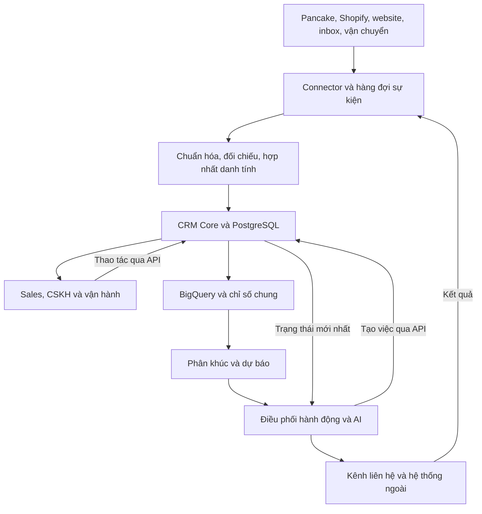

# CRM toàn cầu tích hợp AI và BigQuery

## Tài liệu tổng hợp thiết kế cấp cao và khảo sát mã nguồn mở

- **Ngày tổng hợp:** 28/10/2026.
- **Phiên bản:** 1.0 — định hướng thiết kế và lựa chọn nền tảng.
- **Phạm vi:** CRM đa nền tảng bán hàng, đa shop, đa thương hiệu, phục vụ khách tại Mỹ, châu Âu, Saudi, Kuwait và các thị trường khác.
- **Mục đích:** làm đầu vào cho thiết kế chi tiết, đánh giá repository và xây dựng bản thử nghiệm.
- **Trạng thái:** tổng hợp yêu cầu đã trao đổi và đề xuất kiến trúc; chưa phải xác nhận chức năng đã tồn tại trong code của dự án.
- **Mức kiểm chứng nghiên cứu:** đã đối chiếu tài liệu chính thức, repository và một số thư mục/mô tả triển khai. Chưa cài chạy hoặc đánh giá bảo mật, hiệu năng và chất lượng mô hình của các sản phẩm.

## Mục lục

1. [Mục tiêu và phạm vi](#1-mục-tiêu-và-phạm-vi)
2. [Nguyên tắc kiến trúc](#2-nguyên-tắc-kiến-trúc)
3. [Các module nghiệp vụ](#3-các-module-nghiệp-vụ)
4. [Mô hình dữ liệu chung](#4-mô-hình-dữ-liệu-chung)
5. [Tích hợp đa nền tảng](#5-tích-hợp-đa-nền-tảng)
6. [Customer 360 và vận hành toàn cầu](#6-customer-360-và-vận-hành-toàn-cầu)
7. [Đánh giá khách hàng và insight](#7-đánh-giá-khách-hàng-và-insight)
8. [Thiết kế AI](#8-thiết-kế-ai)
9. [Vai trò BigQuery và báo cáo](#9-vai-trò-bigquery-và-báo-cáo)
10. [Kiến trúc tổng thể](#10-kiến-trúc-tổng-thể)
11. [Bài học từ các CRM lớn](#11-bài-học-từ-các-crm-lớn)
12. [Mã nguồn mở đã có AI](#12-mã-nguồn-mở-đã-có-ai)
13. [Phương án lựa chọn nền tảng](#13-phương-án-lựa-chọn-nền-tảng)
14. [Lộ trình và tiêu chí nghiệm thu](#14-lộ-trình-và-tiêu-chí-nghiệm-thu)
15. [Thông tin cần chốt trước triển khai](#15-thông-tin-cần-chốt-trước-triển-khai)
16. [Nguồn tham khảo](#16-nguồn-tham-khảo)

## 1. Mục tiêu và phạm vi

CRM cần kết nối dữ liệu khách hàng, đơn hàng và hoạt động kinh doanh để trả lời: **nên chăm sóc ai, vào lúc nào, bằng cách nào và kết quả có tạo thêm giá trị hay không?**

### 1.1. Nhu cầu cốt lõi

- Nhận dữ liệu từ Pancake POS, Shopify, website và các nguồn bán hàng khác.
- Hợp nhất hồ sơ và lịch sử khách trong phạm vi được phép.
- Tránh tính trùng đơn khi cùng giao dịch xuất hiện ở nhiều hệ thống.
- Phân tích nhu cầu, hành vi, mua lại, hoàn hàng và giá trị kinh tế.
- Chấm điểm khách phục vụ hành động cụ thể của sales, marketing và CSKH.
- Phối hợp các đội marketing, sales, mua hàng và vận đơn.
- Tích hợp AI để tóm tắt, tìm kiếm, nhập liệu, phân tích, đề xuất và thực hiện tác vụ có kiểm soát.
- Hoạt động đa quốc gia, tiền tệ, ngôn ngữ, múi giờ và thương hiệu.

### 1.2. Ranh giới triển khai ban đầu

- CRM riêng quản lý hồ sơ, nhu cầu mua, phân công, chăm sóc và phân tích.
- Pancake POS/Shopify tiếp tục giữ vai trò nguồn vận hành theo từng nghiệp vụ trong giai đoạn đầu.
- Theo cấu hình đã trao đổi, webhook Pancake đang phục vụ LevelUp; CRM dùng API polling phù hợp để không gián đoạn đối soát.
- Ban đầu ưu tiên đồng bộ chỉ đọc từ nguồn đơn. Ghi ngược phải được thiết kế, cấp quyền và kiểm thử riêng.
- Quyền POS không mặc nhiên bao gồm quyền đọc hội thoại Inbox.
- Kho, mua hàng, kế toán và vận chuyển có thể tích hợp với hệ thống chuyên trách; phạm vi thay thế toàn bộ cần quyết định riêng.

## 2. Nguyên tắc kiến trúc

| Nguyên tắc | Quyết định thiết kế |
|---|---|
| Lõi độc lập nền tảng | Pancake và Shopify là connector, không định nghĩa toàn bộ mô hình CRM |
| Tách vận hành và phân tích | PostgreSQL phục vụ giao dịch; BigQuery phục vụ phân tích lịch sử |
| Một giao dịch kinh doanh | Liên kết các bản ghi nguồn của cùng đơn, không cộng trùng doanh thu |
| Phân biệt sự thật và suy luận | Dữ liệu nguồn, quy tắc tính và kết luận AI có dấu vết riêng |
| Quyền xuyên hệ thống | Màn hình, API, báo cáo, tìm kiếm, xuất dữ liệu và AI cùng tuân thủ quyền |
| Cấu hình theo thị trường | Quốc gia không bị hard-code thành workspace |
| Chuyển đổi từng phần | Đối chiếu và vận hành song song trước khi đổi nguồn dữ liệu chính |
| Đo hiệu quả thực tế | Đo chất lượng dự báo và tác động của hành động riêng biệt |

BigQuery hỗ trợ nhiều khả năng xử lý dữ liệu, nhưng Google khuyến nghị dùng cơ sở dữ liệu phục vụ OLTP cho cập nhật từng dòng thường xuyên. Vì vậy không dùng BigQuery làm database duy nhất cho màn hình CRM hằng ngày. [S1]

## 3. Các module nghiệp vụ

| Module | Chức năng chính |
|---|---|
| Kết nối dữ liệu | Xác thực nguồn, backfill, đồng bộ gia tăng, nhận sự kiện, theo dõi lỗi |
| Customer 360 | Hồ sơ, danh tính nguồn, đơn, tương tác, phân khúc, điểm và lịch sử |
| Nhu cầu mua | Sản phẩm quan tâm, tiến độ tư vấn, lý do chưa mua, hành động tiếp theo |
| Đơn hàng | Tổng hợp đơn, dòng sản phẩm, thanh toán, giao hàng, hoàn tiền và nguồn |
| Không gian sales | Hàng đợi, cuộc gọi, lịch hẹn, nhiệm vụ, kịch bản và chuyển phụ trách |
| Dịch vụ sau bán | Ticket, giao chậm, lỗi hàng, đổi trả, bảo hành, thời hạn xử lý |
| Điều phối chăm sóc | Luồng theo sự kiện/phân khúc, điều kiện vào/ra, giới hạn liên hệ |
| Marketing | Phân khúc, chiến dịch, nguồn khách, nội dung và thử nghiệm |
| Vận đơn | Đơn cần can thiệp, lý do thất bại, phối hợp xử lý và đối soát |
| Sản phẩm/mua hàng | Thông tin SKU, giá vốn, nhà cung cấp, tồn khả dụng qua tích hợp |
| Tri thức | Chính sách, hướng dẫn, FAQ theo thương hiệu/thị trường; có phiên bản |
| Báo cáo | Phễu, cohort, mua lại, doanh thu, lợi nhuận và hiệu quả chăm sóc |
| Trung tâm AI | Trợ lý chung, chức năng AI tại màn hình, lịch tác vụ, chất lượng và chi phí |
| Quản trị | Thành viên, vai trò, cấu hình, audit, sao lưu và vòng đời dữ liệu |

Giao diện có thể dùng các mục **Khách hàng – Nhu cầu mua – Đơn hàng – Chăm sóc**. Không bắt buộc đưa mô hình Companies/Deals B2B lên giao diện nếu nghiệp vụ chưa cần; có thể mở rộng khi phát sinh bán buôn hoặc hợp đồng doanh nghiệp.

## 4. Mô hình dữ liệu chung

| Nhóm | Thực thể đề xuất | Ý nghĩa |
|---|---|---|
| Tổ chức | Workspace, Brand, Store, Market, Connection | Ranh giới dữ liệu, thương hiệu, shop, thị trường và kết nối |
| Khách | Customer, CustomerIdentity, Address, ContactPreference | Hồ sơ chung, mã nguồn, địa chỉ và lựa chọn liên hệ |
| Bán hàng | Lead/BuyingIntent, Assignment, Activity, Task | Nhu cầu mua, phụ trách, tương tác và công việc |
| Giao dịch | Order, OrderItem, SourceOrderLink | Đơn chuẩn, dòng sản phẩm và liên kết nguồn |
| Sản phẩm | Product, Variant, SourceProductMapping | Danh mục chung và ánh xạ mã nguồn |
| Tiền | Payment, Refund, Settlement | Thanh toán, hoàn tiền, đối soát thực thu |
| Giao hàng | Shipment, Return, DeliveryEvent | Vận chuyển, trả hàng và lịch sử trạng thái |
| Dịch vụ | Case/Ticket, SLA, KnowledgeArticle | Yêu cầu hỗ trợ, cam kết xử lý và tri thức |
| Marketing | Campaign, Touchpoint, Segment, Journey | Nguồn tiếp cận, phân khúc và hành trình |
| Phân tích | CustomerMetric, Score, Prediction, Experiment | Chỉ số, điểm, dự báo và thử nghiệm |
| AI | AgentRun, ToolCall, Suggestion, Approval | Lần chạy, công cụ, đề xuất và phê duyệt |
| Kỹ thuật | SourceEvent, SyncCheckpoint, AuditLog | Sự kiện nguồn, điểm tiếp tục đồng bộ và truy vết |

Các bản ghi nhập cần giữ `workspace_id`, `connection_id`, `source_platform`, `source_store_id`, `source_record_id`, `source_updated_at`, `ingested_at` và tham chiếu dữ liệu gốc theo chính sách lưu.

Khóa chống trùng bản ghi nguồn nên bao gồm phạm vi tổ chức/kết nối, loại bản ghi và mã nguồn. Khóa này xử lý nhập lặp từ một nguồn; liên kết cùng giao dịch giữa hai nguồn là bài toán riêng.

Tách trạng thái **đơn**, **thanh toán**, **giao hàng**, **hoàn/đổi**. Giữ trạng thái nguyên bản để truy vết và hỗ trợ giao từng phần, hoàn một phần.

## 5. Tích hợp đa nền tảng

### 5.1. Trách nhiệm connector

Mỗi connector cần khai báo khả năng đọc/ghi, đối tượng hỗ trợ, sự kiện, quyền và giới hạn. Luồng chuẩn:

1. Kết nối tài khoản/shop và kiểm tra quyền.
2. Nạp lịch sử có phân trang và checkpoint.
3. Đồng bộ gia tăng qua API hoặc webhook tùy nguồn.
4. Chuẩn hóa dữ liệu và ánh xạ trạng thái.
5. Chống xử lý lặp, xử lý cập nhật đến muộn, retry có giới hạn.
6. Đưa lỗi không xử lý được vào hàng đợi để rà soát/replay.
7. Đối chiếu định kỳ và hiển thị mức độ mới của dữ liệu.

| Nguồn | Cách tiếp cận |
|---|---|
| Pancake POS | API polling gia tăng theo quyền, giới hạn và cơ chế nguồn cho phép |
| Shopify | GraphQL Admin API, webhook và đối chiếu định kỳ |
| Website riêng | API/sự kiện cho lead, đơn, giỏ hàng và hành vi khi đủ điều kiện |
| Sàn thương mại | Theo API, quyền và mức dữ liệu khách được nền tảng cung cấp |
| Vận chuyển | API, webhook hoặc file đối soát |
| Inbox/cuộc gọi | Connector độc lập; cần quyền hội thoại/ghi âm tương ứng |

Shopify cảnh báo webhook có thể lặp và cần job đối chiếu qua API. Lịch sử đơn mặc định chỉ truy cập 60 ngày; dữ liệu cũ hơn và thông tin khách cần quyền phù hợp. Phải kiểm tra quyền trước khi cam kết độ đầy đủ của Customer 360. [S2–S4]

### 5.2. Ví dụ tránh trùng doanh thu

Khách đặt trên Shopify, đơn được đẩy sang Pancake xử lý, rồi CRM nhập cả hai. Hệ thống phải lưu **một đơn kinh doanh với hai liên kết nguồn**.

- Ưu tiên liên kết bằng mã đơn gốc/tham chiếu tích hợp.
- Không tự gộp chỉ vì trùng số tiền, số điện thoại hoặc thời điểm.
- Nếu chưa đủ bằng chứng, đưa vào danh sách cần xác minh.

### 5.3. Nguồn chính theo trường dữ liệu

| Thông tin | Nguồn chịu trách nhiệm trong ví dụ |
|---|---|
| Kênh đặt hàng, thông tin đặt gốc | Shopify |
| Tiến độ xử lý nội bộ | Pancake nếu đang vận hành tại đó |
| Thanh toán/hoàn tiền | Hệ thống thực sự xử lý giao dịch |
| Giao hàng/COD | Hãng vận chuyển và hệ thống đối soát |
| Phụ trách, nhiệm vụ, ghi chú chăm sóc | CRM |

Quy tắc này cần cấu hình theo từng luồng, tránh bản ghi cũ ghi đè thông tin mới và tránh vòng lặp khi bật đồng bộ hai chiều.

## 6. Customer 360 và vận hành toàn cầu

### 6.1. Hồ sơ hợp nhất

Một khách có thể có nhiều mã ở Pancake, Shopify và inbox. Hồ sơ chung cần liên kết các mã bằng bằng chứng phù hợp; lưu lịch sử gộp và cho phép tách lại.

- Không dùng tên hoặc IP làm bằng chứng đủ để tự động gộp.
- Chuẩn hóa số điện thoại với mã quốc gia, xét khả năng dùng chung.
- Đánh giá chất lượng email, trạng thái xác minh và phạm vi chia sẻ.
- Không mặc định chia sẻ toàn bộ hồ sơ giữa các workspace/thương hiệu.
- Chỉ có đơn hàng thì chủ yếu phân tích được người đã mua; đánh giá lead chưa mua cần nguồn lead/tương tác bổ sung.

### 6.2. Dữ liệu quốc tế

| Yêu cầu | Thiết kế |
|---|---|
| Quốc gia | Tách nơi giao, nơi thanh toán và thông tin khách khai báo |
| Ngôn ngữ | Lưu lựa chọn của khách, không suy ra hoàn toàn từ quốc gia |
| Thời gian | Lưu chuẩn, hiển thị theo địa phương; lịch tác vụ xử lý cả thay đổi giờ mùa hè |
| Tiền tệ | Lưu nguyên tệ, tỷ giá, ngày/tài liệu quy đổi và đồng tiền báo cáo |
| Địa chỉ | Hỗ trợ cấu trúc khác nhau, giữ bản gốc và kết quả chuẩn hóa |
| Quyền liên hệ | Theo kênh, mục đích, thương hiệu và lịch sử lựa chọn |
| Vận hành | Lịch làm việc, phương thức thanh toán và chính sách giao/hoàn theo thị trường |

Một Shopify store có thể bán nhiều quốc gia; một thị trường có nhiều store. Không đồng nhất shop, quốc gia và workspace.

## 7. Đánh giá khách hàng và insight

### 7.1. Bộ chỉ số nhiều chiều

| Chiều | Dữ liệu gợi ý | Quyết định |
|---|---|---|
| Mức phù hợp | Nhu cầu, ngân sách được khai báo, sản phẩm, khả năng phục vụ | Tiếp tục tư vấn sản phẩm nào |
| Ý định mua | Hỏi giao hàng, chọn mẫu, số lượng, xác nhận đặt | Ưu tiên sales |
| Tương tác | Lần phản hồi gần nhất, tiến triển trao đổi | Thời điểm liên hệ |
| Giá trị đã tạo | Mua gần đây, tần suất, chi tiêu ròng, lợi nhuận | Giữ chân và phân tầng phục vụ |
| Mua lại | Chu kỳ mua, danh mục, nhu cầu bổ sung | Chăm sóc/tư vấn mua tiếp |
| Rủi ro giao dịch | Lịch sử nhận hàng, lý do hoàn, thông tin thiếu | Xác nhận hoặc kiểm tra thêm |
| Nhu cầu hỗ trợ | Khiếu nại, mức nghiêm trọng, thời gian chờ | Ưu tiên CSKH |
| Độ tin cậy | Độ đầy đủ, độ mới và chất lượng dữ liệu | Quyết định có dùng kết quả hay không |

Salesforce phân biệt mức phù hợp và mức quan tâm; RFM dùng độ gần của lần mua, tần suất và giá trị tiền. Đây là phương pháp tham khảo, còn định nghĩa giao dịch hợp lệ cần điều chỉnh theo nghiệp vụ. [S5–S6]

### 7.2. Quy tắc chấm điểm khởi đầu

Ví dụ điểm ưu tiên sales cho lead mới, **chỉ là giả thuyết để thử nghiệm**:

| Thành phần | Trọng số |
|---|---:|
| Nhu cầu phù hợp | 25 |
| Tín hiệu mua rõ | 35 |
| Tương tác gần và có tiến triển | 25 |
| Sẵn sàng đặt: mẫu, số lượng, thời điểm | 15 |
| Tổng | 100 |

Điểm 80/100 không đồng nghĩa xác suất mua 80%. Lưu lý do, phiên bản, thời điểm tính, dữ liệu thiếu và hành động đề xuất. Khách chưa có lịch sử là “chưa đủ dữ liệu”, không mặc định rủi ro cao.

### 7.3. RFM, lợi nhuận và dự báo

- Phân biệt giá trị đã tạo với CLV/giá trị tương lai dự báo.
- Với COD, phân tích riêng đơn giao thành công, COD đã thu và đã đối soát.
- Doanh thu ròng và lợi nhuận phải tính theo định nghĩa thống nhất, xử lý hoàn tiền/chiết khấu và chi phí có dữ liệu.
- Không quy lỗi hãng vận chuyển thành chất lượng khách hàng.
- Ngưỡng cần xét thị trường, danh mục, chu kỳ mua và kênh; nhóm ít dữ liệu dùng quy tắc chung.
- Quốc gia là bối cảnh phục vụ, không phải nhãn chất lượng khách.
- Mục tiêu dự báo phải rõ: mua trong 7 ngày, mua lại trong 60 ngày, hoặc giao thành công. Kiểm thử theo thời gian và tránh dùng dữ liệu tương lai để chấm quá khứ.
- Đo độ đúng của mô hình riêng với tác động của chiến dịch. Khách mua sau nhận tin chưa chứng minh tin nhắn tạo ra giao dịch; dùng nhóm đối chứng khi phù hợp.

### 7.4. Insight dẫn đến hành động

| Insight | Hành động |
|---|---|
| Ý định mua cao, chưa ai xử lý | Giao sales và hạn phản hồi |
| Gần chu kỳ mua lại | Tạo nhiệm vụ hoặc đưa vào luồng phù hợp |
| Khách giá trị cao đang gặp sự cố | Ưu tiên xử lý dịch vụ |
| Nguồn quảng cáo nhiều đơn nhưng hoàn cao | Kiểm tra thông điệp, sản phẩm, nguồn và giao vận |
| Sản phẩm doanh thu cao nhưng lợi nhuận thấp | Rà soát giá vốn, chiết khấu, vận chuyển, hoàn hàng |

## 8. Thiết kế AI

### 8.1. Tham khảo MISA AMIS CRM

Người dùng cung cấp video và bản tóm tắt bốn nhóm: phân tích/dự báo, nhập liệu, tìm kiếm/ra lệnh, tương tác/nội dung. Video chưa truy xuất được trực tiếp; các chức năng đã đối chiếu thêm bằng tài liệu MISA. Không coi toàn bộ lời quảng bá hoặc số lượng “30+” là kết quả kiểm thử độc lập. [S13–S17]

| Nhóm | Chức năng đề xuất cho CRM |
|---|---|
| Phân tích | Tóm tắt Customer 360, phân tích biến động, dự báo mua lại/giảm mua, đề xuất hành động |
| Nhập liệu | Trích xuất email, tài liệu, hội thoại thành hồ sơ, nhu cầu, đơn nháp hoặc nhiệm vụ |
| Tìm kiếm/thao tác | Tìm khách bằng ngôn ngữ tự nhiên, mở báo cáo, tạo việc, đề xuất sửa bản ghi |
| Nội dung/tương tác | Soạn phản hồi đa ngôn ngữ, tóm tắt cuộc gọi, chatbot tri thức, nội dung marketing |

Các tiện ích như tra mã số thuế hay địa chỉ hành chính là chức năng địa phương hóa, cần nguồn đáng tin cậy theo quốc gia. Tạo ảnh/xóa nền là phần mở rộng, ưu tiên sau dữ liệu và quy trình bán hàng.

### 8.2. Phân vai công nghệ

| Công nghệ | Trách nhiệm |
|---|---|
| SQL và quy tắc | Doanh thu, RFM, điều kiện phân công, tồn kho và điều kiện liên hệ |
| Mô hình dự báo | Xác suất mua/mua lại/giảm mua và các dự báo được kiểm chứng |
| LLM | Hiểu ngôn ngữ, trích xuất tín hiệu, tóm tắt, giải thích, viết nội dung và gọi công cụ |
| Nhận dạng giọng nói/OCR | Chuyển ghi âm hoặc tài liệu thành dữ liệu để xử lý tiếp |

LLM có thể trích xuất tín hiệu ý định mua; không tự tạo xác suất chuyển đổi thiếu căn cứ. Dữ liệu đã có API thì ưu tiên đồng bộ có cấu trúc.

### 8.3. Ba bề mặt sử dụng

1. **Trợ lý chung:** hỏi dữ liệu, tìm chức năng, yêu cầu tác vụ.
2. **AI trong màn hình:** tóm tắt ở hồ sơ, hỗ trợ nhập ở đơn, gợi ý ở ticket, phân tích ở báo cáo.
3. **Tác vụ nền:** cập nhật điểm, phát hiện bất thường, chuẩn bị báo cáo, tạo nhắc việc theo cấu hình.

### 8.4. Luồng thực hiện tác vụ

Hiểu yêu cầu → xác định khách/đơn → kiểm tra quyền → lấy trạng thái mới nhất → chuẩn bị thay đổi → phê duyệt khi cần → gọi API nghiệp vụ → ghi audit và trả kết quả.

- Bản ghi mơ hồ hoặc thiếu SKU/tiền tệ phải được làm rõ trước khi ghi.
- Nội dung khách gửi là dữ liệu, không được dùng để vượt quyền hoặc thay quy trình.
- Agent chỉ được cấp công cụ cần thiết; không trao quyền database rộng trực tiếp cho mô hình.
- Giá, tồn, giao hàng và chính sách phải lấy từ nguồn hiện hành.
- Đầu ra cần liên kết bằng chứng, phân biệt dữ kiện và giả thuyết.
- Gửi tin, sửa dữ liệu nguồn và tác vụ tài chính có mức quyền/phê duyệt riêng.
- Log không chứa bí mật; dữ liệu gửi đến model chỉ nằm trong phạm vi cần thiết.

### 8.5. Ví dụ hành trình mua lại

1. Khách gần chu kỳ mua tiếp theo.
2. Kiểm tra tồn, khả năng giao, quyền nhận liên hệ và giờ địa phương.
3. Loại khỏi luồng nếu đã có đơn mới, vừa từ chối hoặc đang có khiếu nại cần xử lý.
4. Soạn nội dung theo ngôn ngữ/nhu cầu hoặc tạo việc cho sales.
5. Ghi kết quả, dừng khi đạt điều kiện và đo tác động.

Giới hạn tần suất cần áp dụng xuyên chiến dịch. Cơ chế frequency cap là một năng lực tham khảo từ Dynamics 365. [S8]

### 8.6. Chi phí và chất lượng

- Đồng bộ đơn, SQL và quy tắc thông thường không cần token LLM.
- AI cloud có chi phí theo nhà cung cấp/mức sử dụng; tự host vẫn có chi phí hạ tầng và vận hành.
- Theo dõi chi phí theo workspace, tính năng, model và lần chạy; đặt ngân sách và giới hạn.
- Đánh giá độ đúng, mức sửa/chấp nhận của nhân viên, lỗi thao tác và hiệu quả kinh doanh.
- Agent gửi báo cáo theo lịch là tính năng của sản phẩm đề xuất, chưa có lịch hay email nào được thiết lập bởi tài liệu này.

## 9. Vai trò BigQuery và báo cáo

### 9.1. Luồng dữ liệu phân tích đề xuất

- Lớp nguồn: giữ payload/sự kiện cần thiết để truy vết và tái xử lý theo chính sách.
- Lớp chuẩn hóa: đơn, khách, tiền và trạng thái đã chuẩn hóa, liên kết và loại trùng.
- Lớp chỉ số: định nghĩa doanh thu, mua lại, cohort, lợi nhuận và nguồn khách.
- Lớp phân tích: dashboard, phân khúc, mô hình dự báo và hỏi đáp AI.
- Đưa kết quả điểm/phân khúc về CRM qua cơ chế có kiểm soát; kiểm tra lại điều kiện hiện tại trước khi hành động.

### 9.2. Nhóm báo cáo

| Nhóm | Chỉ số |
|---|---|
| Sales | Tốc độ phản hồi, liên hệ được, chuyển đổi, kết quả theo nhân viên |
| Khách hàng | RFM, cohort, mua lại, giá trị và lợi nhuận theo nhóm |
| Marketing | Nguồn lead, chi phí, chất lượng khách, mua lại và kết quả thực nhận |
| Vận đơn | Giao thành công, thất bại, hoàn, thời gian giao, COD |
| Tài chính quản trị | Doanh thu gộp/ròng, thực thu/đối soát, chi phí và lợi nhuận theo định nghĩa |
| AI | Mức sử dụng, chất lượng, lỗi, chi phí và kết quả tác vụ |

Mỗi báo cáo hiển thị phạm vi shop/thị trường, tiền tệ, thời gian, độ mới dữ liệu và định nghĩa chỉ số. Hỏi đáp bằng AI dùng tài khoản chỉ đọc, phạm vi dữ liệu theo quyền và giới hạn truy vấn/chi phí. Không đưa BigQuery vào đường bắt buộc của thao tác tạo nhiệm vụ hoặc mở hồ sơ hằng ngày.

## 10. Kiến trúc tổng thể

### 10.1. Nền tảng triển khai

- Khởi đầu bằng backend chia module rõ ràng cùng các worker đồng bộ/phân tích/AI.
- Có thể tiếp tục nền TypeScript/PostgreSQL đang nghiên cứu; không bắt buộc viết lại toàn hệ thống.
- Tách dịch vụ theo tải và nhu cầu vận hành thực tế, không mặc định xây nhiều microservice.
- Mỗi phần tích hợp có hợp đồng dữ liệu, kiểm thử, phiên bản và khả năng thay connector.
- Workflow và cấu hình quan trọng cần sandbox, phiên bản, audit và khả năng rollback.

### 10.2. Yêu cầu phi chức năng

| Nhóm | Yêu cầu cần chốt |
|---|---|
| Độ tin cậy | Retry, checkpoint, replay, chống xử lý lặp, giám sát lỗi |
| Hiệu năng | Số người đồng thời, thời gian đáp ứng và độ trễ đồng bộ mục tiêu |
| Bảo mật | Quyền theo workspace/shop/bản ghi/trường; quản lý secret; SSO/MFA theo nhu cầu |
| Khôi phục | Sao lưu, kiểm tra phục hồi và mục tiêu mất dữ liệu/thời gian gián đoạn |
| Toàn cầu | Vùng triển khai, độ trễ, phạm vi lưu/chuyển dữ liệu và cấu hình địa phương |
| Vòng đời dữ liệu | Lưu, xuất, sửa, xóa; truyền thay đổi tới các hệ thống nhận dữ liệu |
| Chi phí | Ngân sách hạ tầng, BigQuery, model, email/tin nhắn và tích hợp |

Các yêu cầu quản trị theo thị trường cần được xác định riêng khi triển khai. Tài liệu không khẳng định một cấu hình chung đủ đáp ứng mọi yêu cầu pháp lý tại mọi quốc gia.

## 11. Bài học từ các CRM lớn

Đây là đối chiếu năng lực của các nền tảng lớn, không phải bảng xếp hạng thị phần.

| Nền tảng | Năng lực đã tham khảo | Bổ sung vào thiết kế |
|---|---|---|
| Salesforce | Sales, Service, Marketing, Commerce; hợp nhất dữ liệu/danh tính | Hồ sơ và lịch sử chung xuyên đội [S7] |
| Dynamics 365 | Customer Insights/Journeys, routing, SLA | Điều phối, giao đúng người, thời hạn xử lý [S8] |
| HubSpot | Smart CRM và các hub marketing/sales/service/data | Trải nghiệm liên thông và workflow xuyên chức năng [S9] |
| SAP CDP | Chuẩn hóa, hợp nhất danh tính, mục đích dữ liệu | Mức tin cậy hồ sơ và quản trị dữ liệu [S10] |
| Oracle Unity | Phân khúc, dự báo, đề xuất hành động | Điểm phục vụ quyết định giữ chân/bán thêm [S11] |
| Zoho CRM | Blueprint, territory, tùy chỉnh, sandbox | Quy trình cấu hình được và thử trước khi phát hành [S12] |

Các phần được bổ sung mạnh sau đối chiếu: dịch vụ sau bán, nhu cầu mua, hàng đợi nhân viên, phân công theo năng lực, giới hạn liên hệ, quản lý tri thức, thử nghiệm và quản trị thay đổi.

## 12. Mã nguồn mở đã có AI

“Đã có” ở đây nghĩa là có chức năng trong tài liệu hoặc mã nguồn được quan sát; không đồng nghĩa đã kiểm thử phù hợp production của dự án. Giấy phép và ranh giới miễn phí/thương mại có thể thay đổi theo phiên bản, cần kiểm tra lại commit/tag khi lựa chọn.

### 12.1. Bảng lựa chọn

| Dự án | Phần AI đã xác minh | Áp dụng | Giới hạn chính |
|---|---|---|---|
| [Twenty](https://github.com/twentyhq/twenty) | Chatbot theo ngữ cảnh, AI workflow, agent nhiều bước, quyền theo object | Nền CRM và trợ lý chung | Cần connector/đơn hàng thương mại và đối soát |
| [Comp AI CRM](https://github.com/trycompai/crm) | Agent riêng, hàng đợi, lịch chạy, lịch sử, bổ sung thông tin có bằng chứng | Phát triển tiếp hướng agent | Thiên B2B; cần rà soát quyền theo shop/đội |
| [Auxx.ai](https://github.com/Auxx-Ai/auxx-ai) | AI phản hồi ticket, email, ngữ cảnh Shopify, tri thức, workflow | Chăm sóc Shopify | Cần Pancake và phân tích xuyên nguồn |
| [Krayin](https://github.com/krayin/laravel-crm) | Magic AI trích xuất tài liệu thành lead | Nhập liệu thông minh | AI xác minh tập trung vào nhập liệu; stack PHP |
| [Relaticle](https://github.com/relaticle/relaticle) | MCP/API cho AI, thao tác dữ liệu, lịch sử, pipeline | Trợ lý thao tác CRM | Thiên B2B; cần nghiệp vụ thương mại |
| [WrenAI](https://github.com/Canner/WrenAI) | Semantic layer, SQL qua agent, BigQuery/PostgreSQL | Hỏi đáp phân tích | Là lớp phân tích; phân biệt engine mở và tính năng thương mại |

### 12.2. Twenty

- Có trợ lý hỏi dữ liệu và tóm tắt tương tác theo màn hình; workflow phân loại, bổ sung dữ liệu, soạn follow-up. [S18]
- Đã quan sát các module `ai-chat`, `ai-agent-execution`, `ai-agent-trigger`, `ai-evaluation` trong mã nguồn.
- Phù hợp đánh giá nếu cân nhắc thay nền CRM.
- Cần xây mô hình đơn chuẩn, connector Pancake, liên kết giao dịch, giao/hoàn/COD.
- Giấy phép: phần lớn AGPLv3; một số package MIT; các file đánh dấu Enterprise theo giấy phép thương mại. Xem LICENSE tại phiên bản chọn dùng. [S19]

### 12.3. Comp AI CRM

- Có `apps/agent`, cơ chế dispatch, ngân sách tác vụ, đọc lịch sử CRM, tìm bản ghi và bổ sung thông tin từ bằng chứng. [S20]
- Có thể tham khảo/tái sử dụng kiến trúc agent và bổ sung công cụ tra đơn, sản phẩm, tạo nhiệm vụ.
- Tài liệu agent có giả định nội bộ single-tenant; không mặc định quyền shop/đội/toàn cầu đã hoàn chỉnh.
- Chưa xác nhận repo hiện tại của người dùng có đầy đủ các thay đổi upstream đã khảo sát.
- Giấy phép MIT. Ưu tiên đánh giá trước quyết định bỏ nền đang phát triển. [S21]

### 12.4. Auxx.ai

- Dự án mô tả AI hỗ trợ ticket, Gmail/Outlook, Shopify, kho tri thức và workflow; stack Next.js/TypeScript/PostgreSQL/Redis. [S22]
- Đã quan sát các thư mục `shopify`, `agents`, `ai-features`, `kb`, `workflow-engine`.
- Phù hợp thử luồng email hỏi đơn → lấy ngữ cảnh Shopify → tạo phản hồi để nhân viên kiểm tra.
- Cần POC chức năng đồng bộ, quyền và độ đúng trước khi chọn làm nền chính.
- Giấy phép AGPL-3.0. Không coi các mô tả trên website là bằng chứng hiệu năng hay chất lượng production. [S23]

### 12.5. Krayin

- Magic AI có cấu hình model/API key và luồng tải tài liệu, trích xuất tên/email/điện thoại để tạo lead. [S24]
- Dùng Laravel/Vue; core MIT. Các extension thương mại phải kiểm tra riêng. [S25]
- Hữu ích để tham khảo luồng nhập liệu; chưa xác minh bộ dự báo rời bỏ/mua lại đáp ứng yêu cầu hiện tại.

### 12.6. Relaticle

- Có MCP server/REST API, thao tác CRM, lịch sử, pipeline và tách workspace; quan sát được package `Chat`. [S26]
- Dùng Laravel/Filament; AGPL-3.0. README hiện nêu giao diện nguồn chính bằng tiếng Anh, có cấu trúc hỗ trợ dịch.
- Phù hợp học cách cung cấp công cụ cho agent; cần mở rộng orders, shipping và connector.

### 12.7. WrenAI

- Core phục vụ semantic layer/định nghĩa chỉ số, SQL và ngữ cảnh cho agent; có nguồn BigQuery/PostgreSQL. [S27]
- Core/SDK hiện Apache-2.0; tài liệu theo giấy phép riêng trong bảng LICENSE. [S28]
- README phân biệt engine mở với UI/embedded và quản trị truy cập nâng cao thương mại. Không mặc định toàn bộ trải nghiệm BI là miễn phí.
- Ứng dụng chat-first cũ nằm ở nhánh legacy; phải chọn rõ nhánh/phiên bản và phạm vi tích hợp.
- Cần tự áp dụng quyền và giới hạn truy vấn đúng tại CRM/warehouse nếu dùng engine mở.

### 12.8. Ánh xạ tính năng và khoảng trống

| Nhu cầu | Ứng viên | Tình trạng |
|---|---|---|
| Trợ lý/tóm tắt CRM | Twenty, Comp AI CRM | Có nền triển khai để thử |
| Agent/workflow | Twenty, Comp AI CRM, Relaticle | Có nền; cần công cụ nghiệp vụ của dự án |
| Hỗ trợ khách Shopify | Auxx.ai | Có mô tả và module; cần kiểm thử |
| Nhập liệu tài liệu | Krayin | Có hướng dẫn sử dụng cụ thể |
| Hỏi BigQuery | WrenAI | Có engine/kết nối; cần tích hợp và quản trị |
| Dự báo rời bỏ/mua lại đáng tin | Chưa xác minh giải pháp hoàn chỉnh trong shortlist | Cần dữ liệu, mô hình, baseline và đánh giá |
| Pancake + Shopify chống trùng | Chưa xác minh có sẵn | Phải thiết kế và xây connector/liên kết |
| CRM toàn cầu hoàn chỉnh | Chưa có repo được xác minh đáp ứng toàn bộ | Cần bản địa hóa, quyền, tài chính, vận hành |

## 13. Phương án lựa chọn nền tảng

### 13.1. Hướng ưu tiên

1. Rà soát CRM/Comp AI CRM đang phát triển: mô hình dữ liệu, agent, API, quyền và khả năng mở rộng.
2. Dùng Twenty làm ứng viên đối chiếu về workflow, tùy chỉnh và trải nghiệm AI.
3. Làm POC Auxx.ai cho phần hỗ trợ Shopify nếu ticket/email là ưu tiên.
4. Đánh giá WrenAI như thành phần phân tích BigQuery, không thay vai trò CRM vận hành.
5. Tham khảo Krayin/Relaticle cho từng chức năng; không cần triển khai đồng thời sáu hệ thống.

Quyết định tích hợp qua API hay tái sử dụng mã cần xét giấy phép từng phần, khả năng bảo trì và chi phí nâng cấp. Không ghép nhiều CRM chỉ vì mỗi dự án có một tính năng hấp dẫn.

### 13.2. Các phương án từng được cân nhắc

| Phương án | Khi phù hợp |
|---|---|
| CRM riêng + PostgreSQL + BigQuery | Tự chủ nghiệp vụ, giữ công sức đầu tư và thêm connector |
| Odoo + BigQuery | Nếu phạm vi chuyển sang cả mua hàng, kho, bán hàng, POS/kế toán; cần đánh giá tùy chỉnh riêng [S29] |
| CRM riêng + Chatwoot | Nếu cần lớp inbox đa kênh; không mặc định tất cả tính năng AI thuộc bản mở và không thay thế POS [S30] |

Các lựa chọn Odoo/Chatwoot là hướng kiến trúc bổ sung, không được xếp vào nhóm đã xác minh có đầy đủ AI tương đương MISA.

## 14. Lộ trình và tiêu chí nghiệm thu

| Giai đoạn | Phạm vi | Điều kiện hoàn thành |
|---|---|---|
| 1. Dữ liệu đáng tin | Pancake + Shopify, đơn chuẩn, Customer 360, tiền tệ, quyền, giám sát | Không cộng trùng giao dịch; đối chiếu được số liệu và trạng thái |
| 2. Vận hành hằng ngày | Nhu cầu mua, sales queue, task, ticket, phân công, SLA, tri thức | Mỗi việc có người phụ trách, lịch sử và kết quả |
| 3. AI hỗ trợ và chăm sóc | Tóm tắt, tìm tự nhiên, soạn đa ngôn ngữ, task, hỏi báo cáo; RFM/điểm quy tắc | Kiểm chứng độ đúng, quyền, chi phí và lợi ích sử dụng |
| 4. Dự báo và tự động hóa | Mua lại/giảm mua, đề xuất sản phẩm, workflow có giới hạn | Vượt baseline và có bằng chứng tác động kinh doanh |

### 14.1. Sáu chức năng AI đầu tiên

1. Tóm tắt Customer 360 có nguồn bằng chứng.
2. Tìm khách/đơn bằng ngôn ngữ tự nhiên với bộ lọc minh bạch.
3. Tóm tắt hội thoại/cuộc gọi khi có dữ liệu được phép sử dụng.
4. Soạn phản hồi đa ngôn ngữ từ tri thức và trạng thái mới nhất.
5. Tạo nhiệm vụ/lịch hẹn qua API.
6. Phân tích báo cáo BigQuery từ chỉ số chuẩn.

### 14.2. Bộ tình huống POC bắt buộc

- Một đơn Shopify có bản sao ở Pancake chỉ tính một lần.
- Cùng sự kiện gửi lại không tạo đơn, task hoặc tin nhắn trùng.
- Cập nhật cũ đến muộn không làm lùi trạng thái hiện tại.
- Đơn giao/hoàn một phần không bị ép về một trạng thái sai.
- Gộp khách sai có thể truy vết và tách lại.
- Nhân viên không thấy dữ liệu ngoài quyền qua cả AI, tìm kiếm và báo cáo.
- AI không đoán SKU/đơn khi tên mơ hồ; API từ chối thao tác không đủ quyền.
- Dashboard đa tiền tệ đối chiếu được nguyên tệ và tỷ giá sử dụng.
- Luồng chăm sóc dừng khi khách mua, từ chối hoặc cần xử lý khiếu nại.
- Báo cáo AI nêu được kỳ, phạm vi, nguồn và độ mới dữ liệu; không biến giả thuyết thành kết luận.
- Dự báo được đánh giá bằng dữ liệu ở thời gian sau, không dùng thông tin tương lai.
- Kiểm thử tiếng Việt, tiếng Anh và các ngôn ngữ thị trường ưu tiên bằng tình huống thực tế.

## 15. Thông tin cần chốt trước triển khai

| Thông tin | Tác động |
|---|---|
| Số shop/nền tảng và thị trường ưu tiên | Phạm vi connector và bản địa hóa |
| Khách, đơn/ngày, sự kiện và lịch sử | Hạ tầng, backfill, chi phí và hiệu năng |
| Người dùng đồng thời và đội vận hành | Phân quyền, hàng đợi và SLA |
| Độ trễ đồng bộ chấp nhận được | Polling, webhook, batch/stream |
| Quyền dữ liệu và API hiện có | Khả năng lấy đơn, khách, hội thoại, ghi âm |
| Phạm vi ghi ngược | Quy tắc nguồn chính, kiểm soát thay đổi và phê duyệt |
| Định nghĩa doanh thu/lợi nhuận | Mô hình dữ liệu, đối soát và báo cáo |
| Ngôn ngữ thực sự cần hỗ trợ | UI, tri thức, kiểm thử AI và nhân sự |
| Ngân sách hạ tầng/AI | Chọn model, triển khai, cache và giới hạn |
| Commit/nền hiện tại | Quyết định giữ, mở rộng hoặc chuyển nền |

Chưa có đủ các dữ liệu trên để chốt sizing, thời gian triển khai, chi phí hoặc cam kết chất lượng dự báo. Khuyến nghị hiện tại là làm POC hai nguồn Pancake–Shopify và sáu chức năng AI đầu tiên trước khi mở rộng.

## 16. Nguồn tham khảo

Các liên kết dưới đây là nguồn đã dùng trong quá trình trao đổi. Đặc tả của CRM trong tài liệu là đề xuất riêng; không phải tất cả đều là tính năng có sẵn của các sản phẩm tham khảo.

### Kiến trúc dữ liệu và đánh giá khách

- **[S1]** Google Cloud — [Optimize query computation: OLAP và cập nhật từng dòng](https://docs.cloud.google.com/bigquery/docs/best-practices-performance-compute).
- **[S2]** Shopify — [About webhooks](https://shopify.dev/docs/apps/build/webhooks), [Verify deliveries](https://shopify.dev/docs/apps/build/webhooks/verify-deliveries).
- **[S3]** Shopify — [Order query và giới hạn lịch sử](https://shopify.dev/docs/api/admin-graphql/latest/queries/order).
- **[S4]** Shopify — [Protected customer data](https://shopify.dev/docs/apps/launch/protected-customer-data).
- **[S5]** Salesforce — [Lead qualification: scoring và grading](https://trailhead.salesforce.com/content/learn/modules/lead-qualification-with-scoring-and-grading/explore-lead-qualification-models).
- **[S6]** Shopify — [Customer reports và RFM](https://help.shopify.com/en/manual/reports-and-analytics/shopify-reports/report-types/default-reports/customers-reports).

### Các nền tảng lớn

- **[S7]** Salesforce — [CRM platform](https://www.salesforce.com/crm/), [Data 360](https://help.salesforce.com/s/articleView?id=sf.c360_a_customer360_lm.htm&language=en_US&type=5).
- **[S8]** Microsoft — [Unified profiles và journeys](https://learn.microsoft.com/en-us/dynamics365/customer-insights/data/marketing-get-started), [Unified routing](https://learn.microsoft.com/en-us/dynamics365/customer-service/overview-unified-routing), [SLA](https://learn.microsoft.com/dynamics365/customer-service/define-service-level-agreements), [Frequency cap](https://learn.microsoft.com/en-us/dynamics365/customer-insights/journeys/journey-frequency-cap).
- **[S9]** HubSpot — [Products](https://www.hubspot.com/products), [Product catalog](https://legal.hubspot.com/hubspot-product-and-services-catalog/products).
- **[S10]** SAP — [Customer Data Platform overview](https://help.sap.com/docs/customer-data-platform/user-guide/product-overview).
- **[S11]** Oracle — [Unity Data Platform](https://www.oracle.com/cx/customer-data-platform/).
- **[S12]** Zoho — [Feature comparison](https://www.zoho.com/crm/complete-feature-list.html), [Deploy sandbox](https://help.zoho.com/portal/en/kb/crm/data-administration/sandbox/articles/deploy-sandbox).

### MISA AMIS CRM

- **[S13]** [Video do người dùng cung cấp](https://www.youtube.com/watch?v=UUeR-4SHh9E) — chưa truy xuất trực tiếp; dùng cùng bản tóm tắt của người dùng.
- **[S14]** MISA — [Trợ thủ AI trên AMIS CRM](https://helpcrm.misa.vn/kb/tro-thu-ai-tren-amis-crm/).
- **[S15]** MISA — [Dự báo rời bỏ và ngày mua tiếp](https://helpcrm.misa.vn/kb/tro-ly-ai-du-bao-ty-le-roi-bo-va-ngay-mua-hang-tiep-theo-cua-khach-hang/).
- **[S16]** MISA — [Tìm đơn bằng AI](https://helpcrm.misa.vn/kb/tim-kiem-don-hang-thong-minh-voi-ai/), [Tính năng mới bản web](https://helpcrm.misa.vn/kb/tinh-nang-moi-ban-web/).
- **[S17]** MISA — [Agent phân tích và gửi báo cáo](https://helpcrm.misa.vn/kb/tro-ly-ai-agent-phan-tich-kinh-doanh/).

### Repository và tính năng AI

- **[S18]** Twenty — [AI overview](https://docs.twenty.com/user-guide/ai/overview), [Repository](https://github.com/twentyhq/twenty).
- **[S19]** Twenty — [LICENSE](https://github.com/twentyhq/twenty/blob/main/LICENSE).
- **[S20]** Comp AI CRM — [Tài liệu agent](https://github.com/trycompai/crm/blob/release/docs/agent.md).
- **[S21]** Comp AI CRM — [Repository](https://github.com/trycompai/crm).
- **[S22]** Auxx.ai — [Repository](https://github.com/Auxx-Ai/auxx-ai).
- **[S23]** Auxx.ai — [Giới thiệu chức năng và phạm vi self-host](https://auxx.ai/what-is-auxx-ai).
- **[S24]** Krayin — [Magic AI](https://docs.krayincrm.com/2.x/configure/magic.html).
- **[S25]** Krayin — [Repository](https://github.com/krayin/laravel-crm).
- **[S26]** Relaticle — [Repository](https://github.com/relaticle/relaticle), [AI chat package](https://github.com/relaticle/relaticle/tree/main/packages/Chat).
- **[S27]** WrenAI — [Repository và ranh giới open-core](https://github.com/Canner/WrenAI).
- **[S28]** WrenAI — [Bảng giấy phép theo đường dẫn](https://github.com/Canner/WrenAI/blob/main/LICENSE).

### Phương án vận hành bổ sung

- **[S29]** Odoo — [Danh mục ứng dụng](https://www.odoo.com/page/all-apps).
- **[S30]** Chatwoot — [Các kênh hỗ trợ](https://www.chatwoot.com/features/channels).

---

**Định hướng đề xuất:** giữ lõi CRM độc lập nguồn bán và quốc gia; làm đúng dữ liệu trước; đưa AI vào tác vụ có thể kiểm chứng; chọn mã nguồn mở theo chức năng và mức phù hợp, sau đó mở rộng bằng kết quả POC.
