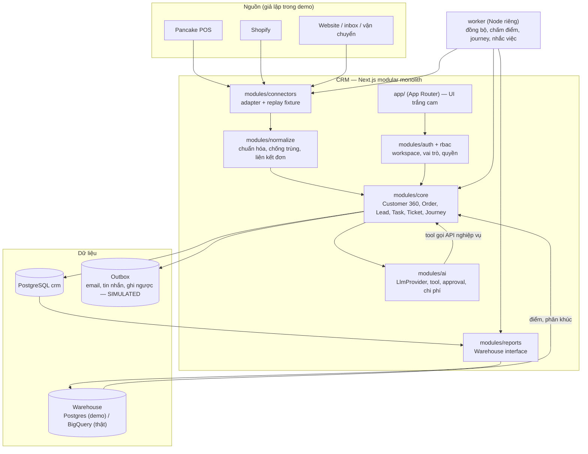
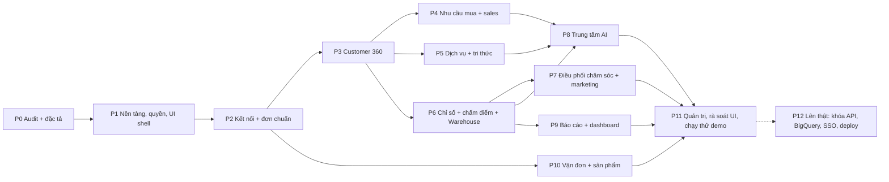

# Thiết kế CRM LevelUp và kế hoạch prompt từng phase cho Claude

- **Ngày lập:** 28/10/2026. **Phiên bản:** 1.0.
- **Nguồn:** `CRM_Global_AI_HLD_Open_Source.md` (HLD, viết tắt **HLD**), `CRM2_Claude_Antigravity_Tom_tat.md` (ràng buộc demo và chia việc), `D:\Work\levelup-company-os` (bối cảnh công ty, từ điển chỉ số REV/MKT/CM/OPS/CASH), `D:\Purchasing System` (stack, mẫu nhiều công ty, mẫu adapter tích hợp).
- **Mục tiêu bản này:** xây **bản demo đầy đủ chức năng chính** của CRM. Mọi thứ cần hệ thống ngoài (Pancake POS, Shopify, BigQuery, LLM, email/SMS, đăng nhập Google) đi qua **adapter có giả lập**; khi lên thật chỉ cần cắm khóa/API vào adapter, không viết lại nghiệp vụ.
- **Cách dùng:** Claude đọc `AGENTS.md`, rồi đọc mục 9 (prompt nền) và mục 10 (prompt từng phase). Mỗi lượt chỉ làm một phase. Các file trong `docs/` là nơi ghi quyết định, trạng thái và bàn giao.

## Mục lục

1. [Mục tiêu và phạm vi](#1-mục-tiêu-và-phạm-vi)
2. [Quyết định thiết kế và mặc định](#2-quyết-định-thiết-kế-và-mặc-định)
3. [Kiến trúc](#3-kiến-trúc)
4. [Menu và phân quyền](#4-menu-và-phân-quyền)
5. [Mô hình dữ liệu và quy tắc cốt lõi](#5-mô-hình-dữ-liệu-và-quy-tắc-cốt-lõi)
6. [Chiến lược demo và điểm cắm tích hợp thật](#6-chiến-lược-demo-và-điểm-cắm-tích-hợp-thật)
7. [Giao diện: hệ thống thiết kế trắng – cam](#7-giao-diện-hệ-thống-thiết-kế-trắng--cam)
8. [Kế hoạch phase](#8-kế-hoạch-phase)
9. [Prompt nền gửi Claude](#9-prompt-nền-gửi-claude)
10. [Prompt từng phase](#10-prompt-từng-phase)
11. [Cách tiếp tục khi Claude hết context](#11-cách-tiếp-tục-khi-claude-hết-context)
12. [Checklist nghiệm thu bản demo](#12-checklist-nghiệm-thu-bản-demo)

## 1. Mục tiêu và phạm vi

### 1.1. CRM phải trả lời được

**Nên chăm sóc ai, lúc nào, bằng cách nào, và kết quả có tạo thêm giá trị không** (HLD §1). Cụ thể cho LevelUp:

- Gom khách và đơn từ nhiều shop/nền tảng bán (Pancake POS, Shopify, website, sàn… — mỗi team có thể dùng nền tảng khác nhau, không giả định trước; D-28) về **một hồ sơ, một đơn kinh doanh**, không tính trùng.
- Cho sales, CSKH, marketing, vận đơn **cùng nhìn một khách**, có người phụ trách, nhiệm vụ, hạn và lịch sử.
- Chấm điểm và tìm insight: RFM, chu kỳ mua lại, rủi ro COD, giá trị theo 4 mốc doanh thu REV-01…REV-04 (từ điển chỉ số LevelUp).
- AI hỗ trợ 6 chức năng đầu tiên (HLD §14.1): tóm tắt 360, tìm bằng ngôn ngữ tự nhiên, tóm tắt hội thoại, soạn phản hồi đa ngôn ngữ, tạo việc qua API, hỏi báo cáo.
- Báo cáo đa shop, đa tiền tệ, có độ mới dữ liệu; lớp phân tích tách khỏi lớp giao dịch để sau cắm BigQuery.

### 1.2. Phạm vi bản demo

| Có trong demo | Không có trong demo (làm khi lên thật) |
|---|---|
| Toàn bộ 14 module HLD §3 ở mức dùng được trên dữ liệu mẫu | Gọi API thật Pancake/Shopify (adapter thật có sẵn khung, chưa có khóa) |
| Adapter Pancake, Shopify chạy chế độ **replay** từ fixture | Webhook công khai, polling lịch thật |
| Warehouse chạy trên PostgreSQL (cùng giao diện với BigQuery) | Dataset BigQuery thật, job ELT |
| LLM chạy chế độ **replay** (kết quả định sẵn, có thể bật Anthropic bằng khóa) | Chi phí token thật, đánh giá chất lượng mô hình |
| Gửi email/tin nhắn ghi vào hàng đợi, **không gửi ra ngoài** | SMTP/SMS thật |
| Đăng nhập thử theo vai trò | Google Workspace SSO (có khung, tắt khi thiếu `GOOGLE_CLIENT_ID`) |
| Chạy trên máy phát triển | Deploy, HTTPS, sao lưu lịch |

### 1.3. Người dùng mục tiêu

Theo cấu trúc LevelUp (D-29): một công ty LevelUp, nhiều **team/đơn vị kinh doanh** (PiAlpha là team mẫu đầu) — mỗi team là một workspace, có MKT, Sales/CSKH, Mua hàng, Vận đơn, Quản lý; quản trị công ty nhìn chéo team. Mỗi team có thể bán qua nền tảng khác nhau (D-28). Người nghiệm thu demo: người dùng và giám đốc (D-30). Số người đồng thời demo: ≤ 20.

## 2. Quyết định thiết kế và mặc định

Mã **D-xx** là quyết định; chi tiết và trạng thái (ĐÃ CHỐT / MẶC ĐỊNH / MỞ) trong `docs/decisions.md`. Tóm tắt:

| Mã | Quyết định |
|---|---|
| D-01 | Stack: **Next.js 15 (App Router) + TypeScript + PostgreSQL + Prisma 6 + Tailwind 4**, worker Node riêng. Cùng stack Purchasing System để tái dùng mẫu nhiều công ty, Decimal, audit, worker. Không dùng FastAPI. |
| D-02 | **Modular monolith**, database riêng `crm`. Không dùng chung DB với Purchasing System, ToolSpy, Pancake CRM. |
| D-03 | **Nhiều workspace tách hoàn toàn** (`workspaceId` trên mọi bảng nghiệp vụ; lớp DB tự gắn; thiếu ngữ cảnh thì từ chối) — mẫu T-53 của Purchasing System. Quản trị công ty chuyển workspace. |
| D-04 | Workspace ≠ Brand ≠ Store ≠ Market. Một workspace có nhiều brand; brand có nhiều store (mỗi store thuộc một nền tảng); store bán nhiều market. Market là danh mục cấu hình, không hard-code. |
| D-28 | **Nền tảng bán là chung chung.** `Store.platform` là mã adapter đăng ký (mở rộng được); Pancake POS và Shopify chỉ là hai adapter đầu. Không giả định team nào dùng gì, không giả định luồng "đơn nền tảng A đẩy sang B"; quy tắc liên kết đơn giữa hai nguồn cấu hình theo cặp nền tảng (`linkRules`). |
| D-29 | **Workspace = team/đơn vị kinh doanh** (ví dụ team PiAlpha); công ty chính là LevelUp. Vai trò cao nhất gọi là **Quản trị công ty**. |
| D-05 | PostgreSQL phục vụ giao dịch; **lớp phân tích đi qua giao diện `Warehouse`** với hai cài đặt: `PostgresWarehouse` (demo) và `BigQueryWarehouse` (khung, cần `GOOGLE_APPLICATION_CREDENTIALS`). Màn hình hằng ngày không chờ warehouse. |
| D-06 | **Một đơn kinh doanh, nhiều liên kết nguồn** (`Order` ↔ `SourceOrderLink`). Chỉ gộp khi có mã tham chiếu gốc; nghi ngờ thì đưa vào hàng đợi xác minh. Không gộp vì trùng tiền/SĐT/thời điểm. |
| D-07 | Tách trạng thái **đơn / thanh toán / giao hàng / hoàn-đổi**; giữ trạng thái nguyên bản của nguồn. Cập nhật đến muộn (`source_updated_at` cũ hơn) không ghi đè. |
| D-08 | Hợp nhất khách bằng bằng chứng: SĐT chuẩn E.164 + email xác minh + mã khách nguồn; tên/IP không đủ. Lưu `MergeLog`, cho phép tách lại. |
| D-09 | Tiền: `Decimal`, lưu nguyên tệ + tỷ giá + ngày quy đổi + tiền báo cáo (USD). Tỷ giá demo seed theo bảng cố định, sửa được ở Danh mục. |
| D-10 | Bốn mốc doanh thu đặt tên theo từ điển LevelUp: **REV-01 Đặt (booked), REV-02 Xác nhận (confirmed), REV-03 Giao thành công (delivered), REV-04 Thực thu (remitted)**. Không có cột "doanh thu" trần. |
| D-11 | Điểm khách hàng là **quy tắc + SQL** có phiên bản, lý do, dữ liệu thiếu; LLM không tự sinh xác suất. Khách chưa đủ dữ liệu ghi "chưa đủ dữ liệu". |
| D-12 | AI đi qua giao diện `LlmProvider`: `ReplayLlm` (demo, kết quả cố định theo fixture) và `AnthropicLlm` (bật bằng `ANTHROPIC_API_KEY`). Mọi lần chạy ghi `AgentRun`/`ToolCall`; tác vụ ghi dữ liệu cần `Approval` khi vượt quyền. |
| D-13 | **`DEMO_MODE=replay`, `EXTERNAL_WRITES_ENABLED=false`** mặc định. Mọi gửi email/tin nhắn/ghi ngược nguồn vào `Outbox` với trạng thái `SIMULATED`. |
| D-14 | Đăng nhập thử (chọn người mẫu theo vai trò), bật bằng `DEMO_LOGIN=true`. Quyền kiểm ở server kể cả gọi API trực tiếp. |
| D-15 | UI tiếng Việt, màu chủ đạo **trắng – cam**, hệ thống thiết kế ở mục 7 và `docs/ui-design-system.md`. Không chồng lớp: một drawer hoặc một modal tại một thời điểm. |
| D-16 | Audit log chỉ thêm, có người thực hiện, workspace, trước/sau. Hành động lặp lại (replay sự kiện, bấm hai lần) không nhân đôi bản ghi (idempotency key). |
| D-17 | Mỗi phase kết thúc bằng test tự động (`vitest`) + kiểm thử trình duyệt trên dữ liệu seed, cập nhật `docs/implementation-status.md` và `docs/handoff.md`. |
| D-18 | Dữ liệu mẫu: công ty LevelUp, 2 workspace = team (PiAlpha, Team EU — hư cấu), 3 brand, 5 store trên ≥ 2 nền tảng (hư cấu), 6 market (US, DE, FR, AE, SA, KW), ~300 khách, ~2.000 đơn 12 tháng, có cặp giao dịch xuất hiện ở hai nguồn, COD các mốc, ticket, hội thoại. Sinh bằng seed có hạt cố định. |
| D-32 | **Nguồn chính theo trường** (HLD §5.3): `Setting.sourceOfTruth` theo cặp nền tảng; "mới hơn thắng" chỉ áp giữa các bản của nguồn chủ trường. Mặc định. |
| D-33 | Trọng số điểm 25/35/25/15 là **giả thuyết v1**, chưa kiểm chứng; hiệu chỉnh bằng dữ liệu thật ở Phase 12. Mặc định. |
| D-27 | **Hai agent, Claude chỉ đạo ~60% / Gemini ~40%** (chỉnh 29/10 từ 80/20): Claude Code là agent chính, làm lõi và review; Gemini qua Antigravity CLI (`agy -p`, runner `tools/agy-runner/run_agy.py`) làm batch độc lập có contract + checker máy (UI component, trang danh sách/form, fixture, mapper, test hàm thuần). Quy trình và bảng giao việc theo phase ở `docs/antigravity-workflow.md`. Claude nghiệm thu mọi output của Gemini. |

## 3. Kiến trúc



Nguyên tắc (HLD §2, §10): lõi độc lập nền tảng; tách vận hành và phân tích; phân biệt sự thật (nguồn) – quy tắc – suy luận AI; quyền xuyên hệ thống (màn hình, API, tìm kiếm, báo cáo, AI cùng một hàm kiểm quyền); cấu hình theo thị trường; đo hiệu quả riêng với dự báo.

Cấu trúc thư mục dự kiến:

```
src/
  app/                 # route theo menu (mục 4), layout chung, (auth)
  modules/<tên>/       # mỗi module: service.ts, queries.ts, schema.ts (zod), actions.ts
  lib/db.ts            # Prisma + bindTenant (gắn workspaceId mọi truy vấn)
  lib/rbac.ts          # requirePerm(user, perm), ma trận docs/permissions.md
  lib/money.ts         # Decimal, quy đổi, định dạng theo tiền tệ
  lib/idempotency.ts
  adapters/
    connectors/registry.ts            # đăng ký adapter theo mã platform (mở rộng được, D-28)
    connectors/<platform>/{adapter.ts,replay.ts,status-map.ts,schema.ts,fixtures/}   # pancake, shopify là hai cái đầu
    warehouse/{interface.ts,postgres.ts,bigquery.ts}
    llm/{interface.ts,replay.ts,anthropic.ts,fixtures/}
    messaging/{interface.ts,outbox.ts,smtp.ts}
  components/ui/       # design system (mục 7)
worker/                # tiến trình riêng: sync, score, journey, reminder
prisma/                # schema, migration, seed, seed-demo
tests/                 # vitest: unit (money, dedupe, score) + integration (DB test)
docs/                  # tài liệu vai trò (xem AGENTS.md)
```

## 4. Menu và phân quyền

Menu chính (sidebar trái, tiếng Việt), theo HLD §3 và nhóm "Khách hàng – Nhu cầu mua – Đơn hàng – Chăm sóc":

| Menu | Đường dẫn | Module | Phase |
|---|---|---|---|
| Tổng quan | `/` | reports | 9 |
| Khách hàng | `/khach-hang`, `/khach-hang/[id]` | customer360 | 3 |
| Nhu cầu mua | `/nhu-cau` | leads | 4 |
| Hàng đợi của tôi | `/hang-doi` | sales | 4 |
| Nhiệm vụ | `/nhiem-vu` | tasks | 4 |
| Đơn hàng | `/don-hang`, `/don-hang/[id]` | orders | 2 |
| Cần xác minh | `/xac-minh` | normalize (trùng đơn, gộp khách) | 2–3 |
| Chăm sóc | `/cham-soc` (ticket), `/cham-soc/[id]` | service | 5 |
| Tri thức | `/tri-thuc` | knowledge | 5 |
| Phân khúc | `/phan-khuc` | marketing | 7 |
| Hành trình | `/hanh-trinh` | journeys | 7 |
| Chiến dịch | `/chien-dich` | marketing | 7 |
| Vận đơn | `/van-don` | fulfillment | 10 |
| Sản phẩm | `/san-pham` | products | 2, 10 |
| Báo cáo | `/bao-cao/[nhom]` | reports | 9 |
| Trợ lý AI | `/ai` (và nút AI ở mọi màn) | ai | 8 |
| Kết nối dữ liệu | `/ket-noi` | connectors | 2 |
| Quản trị | `/quan-tri/{nguoi-dung,vai-tro,danh-muc,audit,cau-hinh}` | admin | 1, 11 |

Vai trò (chi tiết ma trận ở `docs/permissions.md`): **Quản trị công ty** (LevelUp, nhìn chéo team), **Quản lý** (workspace = team), **Sales/CSKH**, **Trưởng nhóm sales**, **Marketing**, **Vận đơn**, **Mua hàng (chỉ xem)**, **Kế toán (chỉ xem tiền)**. Quyền là tập `module.action` (ví dụ `customer.view`, `customer.merge`, `order.view`, `finance.view`, `ai.run`, `ai.approve`, `integration.manage`).

## 5. Mô hình dữ liệu và quy tắc cốt lõi

Thực thể theo HLD §4, ERD đầy đủ ở `docs/data-model.md`. Mọi bảng nghiệp vụ có `workspaceId`, `createdAt`, `updatedAt`, `createdById`. Bản ghi nhập từ nguồn có thêm `connectionId`, `sourcePlatform`, `sourceStoreId`, `sourceRecordId`, `sourceUpdatedAt`, `ingestedAt`, `rawPayloadRef`.

| Nhóm | Bảng |
|---|---|
| Tổ chức | `Workspace`, `Brand`, `Store`, `Market`, `Connection`, `User`, `Membership`, `Role`, `Team` |
| Khách | `Customer`, `CustomerIdentity`, `Address`, `ContactPreference`, `MergeLog` |
| Bán hàng | `Lead`, `Assignment`, `Activity`, `Task` |
| Giao dịch | `Order`, `OrderItem`, `SourceOrderLink`, `OrderLinkReview` |
| Sản phẩm | `Product`, `Variant`, `SourceProductMapping` |
| Tiền | `Payment`, `Refund`, `Settlement`, `FxRate` |
| Giao hàng | `Shipment`, `DeliveryEvent`, `Return` |
| Dịch vụ | `Ticket`, `TicketEvent`, `SlaPolicy`, `KnowledgeArticle` |
| Marketing | `Campaign`, `Touchpoint`, `Segment`, `Journey`, `JourneyRun`, `ContactCap` |
| Phân tích | `CustomerMetric`, `Score`, `ScoreVersion`, `Prediction`, `Experiment` |
| AI | `AgentRun`, `ToolCall`, `Suggestion`, `Approval`, `AiCost` |
| Kỹ thuật | `SourceEvent`, `SyncRun`, `SyncCheckpoint`, `Outbox`, `AuditLog`, `IdempotencyKey` |

Quy tắc bắt buộc (kiểm bằng test):

1. **Chống trùng nguồn:** unique (`workspaceId`, `connectionId`, `recordType`, `sourceRecordId`). Nhập lặp = cập nhật, không tạo mới.
2. **Liên kết đơn hai nguồn (bất kỳ cặp nền tảng nào, D-28):** chỉ tự liên kết khi một nguồn giữ mã tham chiếu của nguồn kia theo `linkRules` cấu hình cho cặp (platformA, trườngA, platformB, trườngB). Không có quy tắc hoặc không khớp mã → ghi `OrderLinkReview` chờ người duyệt. Không gộp vì trùng tiền/SĐT/thời điểm.
3. **Cập nhật đến muộn:** bỏ qua nếu `sourceUpdatedAt` ≤ bản đã lưu; ghi `SourceEvent` với `outcome = STALE`. **Nguồn chính theo trường (HLD §5.3, D-32):** "mới hơn thắng" chỉ áp trong cùng nhóm trường của nguồn chịu trách nhiệm theo `Setting.sourceOfTruth`; nguồn không phải chủ của nhóm trường thì không ghi đè (ghi `SourceEvent` với `outcome = NOT_OWNER`). Có test.
4. **Trạng thái tách:** `Order.status` (đặt/xác nhận/hủy), `Order.paymentStatus`, `Order.fulfillmentStatus`, `Order.returnStatus`; giao/hoàn một phần giữ số lượng theo dòng.
5. **Tiền:** `amount` Decimal(18,4) + `currency` + `fxRate` + `fxDate` + `reportingAmount` (USD). Không cộng hai tiền tệ không quy đổi.
6. **Gộp khách:** `MergeLog` giữ `survivorId`, `mergedId`, `evidence[]`, `mergedById`; tách lại khôi phục `CustomerIdentity` về khách cũ.
7. **Điểm:** `Score` có `version`, `computedAt`, `reasons[]`, `missingData[]`, `suggestedAction`. Không có `Score` thì hiển thị "chưa đủ dữ liệu".
8. **AI:** `AgentRun` lưu prompt (đã lọc bí mật), model, token, chi phí, `ToolCall[]`; tool ghi dữ liệu phải gọi service nghiệp vụ (qua `requirePerm`), không truy cập DB trực tiếp.
9. **Outbox:** mọi gửi ra ngoài tạo `Outbox` với `channel`, `status` (`SIMULATED` khi `EXTERNAL_WRITES_ENABLED=false`), `idempotencyKey`.
10. **Audit:** mọi sửa dữ liệu nghiệp vụ ghi `AuditLog` (`actorId`, `workspaceId`, `entity`, `entityId`, `before`, `after`, `reason`).

## 6. Chiến lược demo và điểm cắm tích hợp thật

Chi tiết ở `docs/demo-strategy.md`. Tóm tắt:

| Thứ cần ngoài | Giao diện trong code | Cài đặt demo | Khi lên thật |
|---|---|---|---|
| Pancake POS | `adapters/connectors/pancake/adapter.ts` (`listOrders(since)`, `listCustomers`, `getShop`) | `replay.ts` đọc `fixtures/*.json` theo mốc thời gian | Điền `PANCAKE_API_KEY`, `PANCAKE_POS_BASE_URL`, xác minh endpoint với tài liệu thật (chưa xác minh, HLD §5) |
| Shopify | `adapters/connectors/shopify/adapter.ts` (GraphQL Admin) | `replay.ts` + fixture | `SHOPIFY_ACCESS_TOKEN`, webhook HMAC, job đối chiếu |
| BigQuery | `adapters/warehouse/interface.ts` (`query(sql, params)`, `refreshMetrics()`) | `postgres.ts` chạy cùng SQL chuẩn trên schema `analytics` | `bigquery.ts` dùng `@google-cloud/bigquery`, dataset do công ty cấp (chưa xác minh dataset PiAlpha và KPI views có tồn tại, D-M2; HLD không nhắc) |
| LLM | `adapters/llm/interface.ts` (`complete`, `completeWithTools`) | `replay.ts`: khớp intent → trả kết quả fixture, kèm bằng chứng | `anthropic.ts` với `ANTHROPIC_API_KEY`, model mặc định `claude-sonnet-5-5` |
| Email/SMS (gửi ra) | `adapters/messaging/interface.ts` | `outbox.ts` ghi `SIMULATED` | `smtp.ts`, kênh thật |
| Inbox (hội thoại vào, connector độc lập HLD §5) | `adapters/connectors/inbox/adapter.ts` (`listConversations(since)`, `capabilities()`), ghi `Activity` loại MESSAGE | `replay.ts` đọc fixture hội thoại; nguồn cho tóm tắt hội thoại Phase 8 | Cần quyền hội thoại (Q-12, D-M4); endpoint "chưa xác minh" |
| Đăng nhập | `modules/auth` | Đăng nhập thử theo vai trò | Google OIDC (`GOOGLE_CLIENT_ID`, `GOOGLE_HD`) |
| Mua hàng/tồn | `modules/products` đọc qua `PurchasingLink` | fixture tồn/giá vốn | API đọc từ Purchasing System |

Nguyên tắc: **không có đường rẽ `if (demo)` trong nghiệp vụ**. Chỉ adapter đổi cài đặt qua env. Test chạy trên replay; adapter thật có test hợp đồng riêng, bỏ qua khi thiếu khóa.

## 7. Giao diện: hệ thống thiết kế trắng – cam

Chi tiết token, component và quy tắc bố cục ở `docs/ui-design-system.md`. Tóm tắt bắt buộc:

- **Màu:** nền `#FFFFFF`, bề mặt phụ `#FAFAF9`, viền `#E7E5E4`, chữ `#1C1917`/`#57534E`, cam chính `#F97316`, cam đậm (hover) `#EA580C`, cam nhạt (nền nhấn) `#FFF7ED`. Trạng thái: xanh `#16A34A`, vàng `#D97706`, đỏ `#DC2626`, xanh dương thông tin `#2563EB`. Cam chỉ dùng cho hành động chính, điểm nhấn, trạng thái đang chọn; không dùng cam làm nền lớn.
- **Chữ:** Be Vietnam Pro (tiếng Việt), fallback Inter; thang 12/14/16/20/24/32.
- **Lưới:** 8px; sidebar cố định 248px (thu gọn 64px), topbar 56px, nội dung tối đa 1440px, padding 24px.
- **Không chồng chéo:** z-index chỉ 5 bậc (`base 0, sticky 10, dropdown 20, drawer 30, modal 40, toast 50`); tại một thời điểm tối đa một drawer **hoặc** một modal; dropdown đóng khi mở drawer; bảng có header dính, không cuộn ngang trong cuộn ngang; panel AI là drawer phải, đóng khi mở drawer khác.
- **Mọi màn có 4 trạng thái:** đang tải (skeleton), rỗng (có hướng dẫn + nút hành động), lỗi (có thử lại), thành công.
- **Thành phần chuẩn:** `AppShell`, `PageHeader` (tiêu đề + mô tả + hành động chính cam), `DataTable` (lọc, sắp xếp, chọn, phân trang, xuất), `Drawer`, `Modal`, `StatCard`, `Timeline`, `Badge` trạng thái, `Form` (zod + lỗi inline), `AiPanel`.
- **Khả năng truy cập:** tương phản AA, focus ring cam, điều hướng bàn phím cho bảng/drawer/modal, nhãn cho mọi input.

## 8. Kế hoạch phase

Số phase là mã định danh. Mũi tên là phụ thuộc. Demo coi là xong khi Phase 11 nghiệm thu.



| Phase | Tên | Kết quả chính | Nghiệm thu |
|---|---|---|---|
| 0 | Audit và đặc tả | Bộ tài liệu này + `docs/` | Người dùng duyệt phạm vi, mặc định |
| 1 | Nền tảng, quyền, UI shell | Scaffold, Prisma, workspace, đăng nhập thử, RBAC, design system, AppShell, audit, danh mục | Đăng nhập 8 vai, chuyển workspace, 403 đúng, UI shell đủ trạng thái |
| 2 | Kết nối dữ liệu và đơn chuẩn | Connection, adapter Pancake/Shopify replay, SourceEvent, SyncRun, Order chuẩn, liên kết nguồn, hàng đợi xác minh, Product mapping | 4 tình huống POC trùng/muộn/một phần/replay |
| 3 | Customer 360 | Customer, identity, hợp nhất có bằng chứng, tách lại, trang 360 timeline | Gộp sai tách lại được; quyền che trường |
| 4 | Nhu cầu mua và không gian sales | Lead, phân công, hàng đợi, task, activity, kịch bản, chuyển phụ trách | Mỗi lead có người, hạn, lịch sử |
| 5 | Dịch vụ sau bán và tri thức | Ticket, SLA, loại sự cố, KnowledgeArticle có phiên bản | SLA đếm đúng, bài tri thức theo brand/market |
| 6 | Chỉ số, chấm điểm, Warehouse | Từ điển chỉ số, CustomerMetric, RFM, Score v1, Warehouse interface + Postgres | Điểm có lý do/phiên bản; SQL chạy cả Postgres lẫn BigQuery cú pháp chuẩn |
| 7 | Điều phối chăm sóc và marketing | Segment, Journey, điều kiện vào/ra, frequency cap, Campaign, Touchpoint, Outbox SIMULATED | Luồng dừng khi khách mua/từ chối/khiếu nại |
| 8 | Trung tâm AI | LlmProvider replay/Anthropic, 6 chức năng AI, tool, approval, chi phí, AiPanel | AI không thấy ngoài quyền; không đoán SKU; có bằng chứng |
| 9 | Báo cáo và dashboard | 6 nhóm báo cáo, đa tiền tệ, độ mới, xuất Excel, dashboard | Đối chiếu nguyên tệ + tỷ giá; kỳ/phạm vi/nguồn rõ |
| 10 | Vận đơn và sản phẩm | Đơn cần can thiệp, lý do thất bại, COD các mốc, sản phẩm/tồn qua PurchasingLink | 4 mốc COD (booked, delivered, collected, remitted) khớp REV-01, REV-03, CASH-01, CASH-02/REV-04 (`docs/metrics.md` mục 3.1) |
| 11 | Quản trị, rà soát UI/UX, chạy thử demo | Admin đủ, audit viewer, cấu hình, kịch bản demo seed, rà soát 4 trạng thái/chồng lớp, E2E | Checklist mục 12 đạt; handoff "điểm cắm" |
| 12 | Lên thật (ngoài demo) | Khóa thật, BigQuery, SSO, SMTP, deploy | Theo `docs/deploy-checklist.md` |

## 9. Prompt nền gửi Claude

```text
Bạn triển khai CRM LevelUp theo file Thiet_ke_CRM_va_prompt_Claude.md và CRM_Global_AI_HLD_Open_Source.md; khi hai file khác nhau, file thiết kế thắng và docs/decisions.md thắng cả hai. Chỉ thực hiện phase tôi chỉ định. Không triển khai toàn bộ roadmap trong một lượt.

Trước khi làm: đọc AGENTS.md, docs/decisions.md, docs/implementation-status.md và docs/handoff.md nếu tồn tại. Audit thực trạng trước khi thêm hoặc sửa. Không tự khẳng định chức năng có sẵn nếu chưa kiểm tra. Không tự đổi stack hoặc viết lại dự án.

Đây là BẢN DEMO đầy đủ chức năng: mọi thứ cần hệ thống ngoài (Pancake, Shopify, BigQuery, LLM, email, SSO) phải đi qua adapter có cài đặt replay/giả lập, và adapter thật chỉ là khung chờ khóa. Không có nhánh if-demo trong nghiệp vụ. Giữ DEMO_MODE=replay, EXTERNAL_WRITES_ENABLED=false. Không gọi API thật, không ghi ngược POS, không gửi email thật, không push, không deploy.

Quy trình mỗi phase:
1. Tóm tắt phạm vi, phần đã có, phần thiếu, file/module dự kiến thay đổi.
2. Làm một luồng đầy đủ database → service → API/action → UI → quyền → test. Phase lớn thì chia lát chạy được, ghi checkpoint.
3. Kiểm rủi ro thật của phase: quyền phía server (kể cả AI, tìm kiếm, báo cáo), tiền và tỷ giá, chống trùng và cập nhật đến muộn, idempotency, cô lập workspace. Không chỉ kiểm build.
4. Cập nhật docs/implementation-status.md, docs/decisions.md (mặc định mới ghi mã D-xx), docs/handoff.md, README khi cần.
5. Dừng khi xong phase hoặc checkpoint an toàn. Gần hết context thì ưu tiên lưu handoff.

Yêu cầu xuyên suốt:
- UI tiếng Việt, trắng – cam theo docs/ui-design-system.md; mỗi màn đủ 4 trạng thái; không chồng lớp (một drawer hoặc một modal).
- Mọi bảng nghiệp vụ có workspaceId; lớp DB tự gắn; thiếu ngữ cảnh thì từ chối.
- Một đơn kinh doanh nhiều liên kết nguồn; không gộp vì trùng tiền/SĐT; nghi ngờ thì vào hàng đợi xác minh.
- Tiền Decimal, nguyên tệ + tỷ giá + USD báo cáo; doanh thu luôn ghi mã REV-01…04.
- Điểm có phiên bản, lý do, dữ liệu thiếu; AI có bằng chứng, không đoán SKU/đơn; tool ghi dữ liệu qua service có kiểm quyền.
- Audit chỉ thêm; hành động lặp không nhân đôi.
- Không bịa API/endpoint/token; endpoint thật ghi "chưa xác minh" đến khi có tài liệu.
- Không đưa bí mật vào git/log/frontend/tài liệu.

Hai agent (D-27): bạn chỉ đạo và tự làm khoảng 60% — thiết kế, contract, schema, quyền, logic tiền/chống trùng/gộp/chấm điểm, AI, tích hợp, review mọi diff, nghiệm thu. Gemini (Antigravity CLI, runner tools/agy-runner/run_agy.py) làm khoảng 40% theo bảng docs/antigravity-workflow.md mục 4: phần lớn trang giao diện dựng trên service bạn đã viết và test, fixture/nội dung đa ngôn ngữ, test bảng, E2E, ảnh chụp. Thứ tự mỗi phase: bạn viết schema + service + test → giao Gemini UI + dữ liệu mẫu (work order + jobs.json + checker ở ai-jobs/<phase>-<slug>/, worktree ../CRM2-gemini) → trong lúc chờ bạn làm lát kế tiếp → git diff + checker + npm test + đọc từng trang trước khi merge. Không tin báo cáo tự nghiệm thu của Gemini. agy không sẵn sàng thì tự làm, không chờ.

Kết thúc phase trả ngắn gọn: đã làm; phần Claude làm / phần Gemini phụ trợ (batch nào, kết quả checker, tỷ lệ ước tính); cách chạy/test; kết quả test thực tế; chưa làm hoặc bị chặn; cách nghiệm thu; phase tiếp theo. Chỉ đánh dấu hoàn thành khi tiêu chí nghiệm thu đạt.
```

## 10. Prompt từng phase

Mỗi prompt dùng kèm prompt nền. Ghi `docs/implementation-status.md` theo mẫu "Phase N — đã làm (ngày)". Từ Phase 3, phần giao Gemini (~40%) của mỗi phase lấy từ `docs/antigravity-workflow.md` mục 4; prompt dưới đây mô tả toàn bộ phạm vi phase, Claude chia việc theo bảng đó.

### Phase 0 — Audit và đặc tả

```text
Phase 0. Repo D:\CRM2 hiện chỉ có tài liệu và bộ skill BA. Đọc toàn bộ Thiet_ke_CRM_va_prompt_Claude.md, HLD, docs/*.md. Liệt kê mọi điểm mâu thuẫn giữa HLD và bản thiết kế, mọi mặc định D-xx chưa có người xác nhận, và câu hỏi còn mở trong docs/questions-for-manager.md. Không viết code. Đề xuất thứ tự lát cho Phase 1. Dừng chờ tôi duyệt.
```

### Phase 1 — Nền tảng, quyền, UI shell

```text0
Phase 1. Lát 1.0 Thiết lập hai agent theo docs/antigravity-workflow.md mục 2: git init (nếu chưa), kiểm agy --version / agy models / agy -p "Reply with exactly READY. Do not use tools." và ghi kết quả vào mục 7 của file đó; chạy python -I tools/agy-runner/test_run_agy.py; sửa 4 mục chặn của runner (prompt qua stdin, search_web = thất bại, mode write bắt buộc có sản phẩm + validator exit 0, validator JSON đúng) kèm test; tạo worktree ../CRM2-gemini. Bị chặn bởi đăng nhập/CLI thì báo đúng bước người dùng phải làm và tiếp tục các lát sau bằng Claude.

Khởi tạo dự án theo D-01: Next.js 15 App Router + TypeScript + Prisma 6 + PostgreSQL + Tailwind 4 + vitest; worker/ là tiến trình Node riêng (chưa có job). Tạo .env.example đủ biến ở docs/demo-strategy.md.

Lát 1.1 Schema tổ chức: Workspace (= team, D-29), Brand, Store (platform: chuỗi mã adapter đăng ký, không enum cố định, D-28), Market, Team, User, Membership (workspaceId, userId, roleId, isActive), Role (permissions string[]), AuditLog, IdempotencyKey. Lớp lib/db.ts với bindTenant theo mẫu Purchasing System T-53: mọi truy vấn bảng thuộc workspace tự lọc/gán workspaceId, thiếu ngữ cảnh thì ném lỗi. Test: truy vấn không có ngữ cảnh bị từ chối; workspace A không thấy dữ liệu B.

Lát 1.2 Đăng nhập thử (DEMO_LOGIN=true): trang /dang-nhap chọn người mẫu theo vai trò; session cookie ký bằng SESSION_SECRET; requireUser, requirePerm(user, 'module.action') theo docs/permissions.md; chuyển workspace cho quản trị công ty. Khung Google OIDC: route và cấu hình, tắt khi thiếu GOOGLE_CLIENT_ID (không bịa flow, ghi "chưa chạy thật").

Lát 1.3 Design system theo docs/ui-design-system.md: Claude làm token CSS, font Be Vietnam Pro, AppShell/Sidebar/Topbar, Drawer + Modal + store overlay (một lớp phủ), DataTable, Form. Có thể giao Gemini batch nhỏ p1-ui-basic (Badge, Skeleton, EmptyState, ErrorState, Toast) với checker tsc + eslint + vitest render 4 trạng thái; Claude review rồi mới dùng. Quy tắc z-index 5 bậc, chỉ một lớp phủ. Trang /quan-tri/nguoi-dung, /quan-tri/vai-tro, /quan-tri/danh-muc (brand, store, market, team, tỷ giá) dùng đủ component. Mỗi trang đủ 4 trạng thái.

Lát 1.4 Seed danh mục: công ty LevelUp, 2 workspace = team (PiAlpha, Team EU), 3 brand, 5 store, 6 market (US, DE, FR, AE, SA, KW) với tiền tệ và loại thanh toán (PREPAID|COD), 8 người mẫu đủ vai, tỷ giá cố định về USD. Seed idempotent.

Nghiệm thu: npm test xanh; đăng nhập từng vai; gọi API trực tiếp thiếu quyền trả 403; đổi workspace thì danh mục đổi; kiểm thử trình duyệt chụp ảnh 4 trạng thái của một trang. Cập nhật docs.
```

### Phase 2 — Kết nối dữ liệu và đơn chuẩn

```text
Phase 2. Lát 2.1 Khung connector: Connection (workspaceId, storeId, platform, status, config mã hóa AES-256-GCM bằng INTEGRATION_SECRET_KEY, pollIntervalMin), SyncRun, SyncCheckpoint, SourceEvent (eventKey unique, outcome: APPLIED|STALE|NOT_OWNER|DUPLICATE|ERROR, rawPayloadRef). Giao diện adapters/connectors/interface.ts: verify(), backfill(since, cursor), incremental(since), capabilities(). Cài đặt replay cho Pancake và Shopify đọc fixtures JSON có mốc thời gian; adapter thật là khung với endpoint ghi "chưa xác minh", test hợp đồng bỏ qua khi thiếu khóa. Trang /ket-noi: thêm kết nối, xác minh (replay luôn đạt), chạy backfill/gia tăng, xem lỗi, replay sự kiện lỗi. Chỉ integration.manage.

Lát 2.2 Đơn chuẩn: Product, Variant, SourceProductMapping; Order (status, paymentStatus, fulfillmentStatus, returnStatus, amounts Decimal nguyên tệ + USD, marketId, storeId, customerRef tạm), OrderItem, Payment, Refund, Shipment, DeliveryEvent, Return. Chuẩn hóa trạng thái từng nền tảng theo bảng ánh xạ trong docs/integrations.md; giữ trạng thái gốc. Quy tắc 1, 3, 4, 5 mục 5 có test.

Lát 2.3 Liên kết đơn hai nguồn (chung cho mọi cặp nền tảng, D-28): Setting.sourceOfTruth (nhóm trường: kênh/đặt gốc, tiến độ xử lý, thanh toán, giao hàng/COD, phụ trách/task → nền tảng chịu trách nhiệm, theo cặp nền tảng; mặc định theo docs/integrations.md mục 5; normalize áp quy tắc này trước "mới hơn thắng"), SourceOrderLink, OrderLinkReview, Setting.linkRules (danh sách quy tắc theo cặp platform + trường tham chiếu; demo seed một quy tắc hư cấu giữa hai adapter đầu). Tự liên kết chỉ khi quy tắc khớp mã; nghi ngờ vào /xac-minh để người có order.link duyệt gộp/tách; gộp ghi MergeLog kiểu đơn. Fixture phải có: 1 giao dịch xuất hiện ở hai nguồn có mã tham chiếu khớp quy tắc; 1 cặp nghi ngờ không mã; 1 sự kiện gửi lặp; 1 cập nhật đến muộn; 1 đơn giao một phần + hoàn một phần. Thêm adapter thứ ba (ví dụ website) chỉ là đăng ký vào registry + fixture, không sửa normalize — có test chứng minh.

Lát 2.4 Trang /don-hang danh sách (lọc store/market/trạng thái/kỳ, xuất Excel) và /don-hang/[id] (dòng, thanh toán, giao hàng, hoàn, nguồn liên kết, sự kiện). Worker job sync chạy theo pollIntervalMin trên replay.

Nghiệm thu: 5 tình huống fixture cho kết quả đúng và có test; doanh thu đơn liên kết chỉ tính một lần; cập nhật muộn không lùi trạng thái; replay sự kiện không tạo đơn mới.
```

### Phase 3 — Customer 360

```text
Phase 3. Customer, CustomerIdentity (platform, sourceCustomerId, phoneE164, emailNormalized, verified), Address (bản gốc + chuẩn hóa, loại giao/thanh toán), ContactPreference (kênh, mục đích, brand, optIn, lịch sử), MergeLog. Gắn Order.customerId từ identity theo quy tắc D-08: tự gộp khi trùng SĐT E.164 hoặc email xác minh hoặc mã khách nguồn; tên/IP không đủ; nghi ngờ vào /xac-minh tab Khách. Gộp giữ lịch sử, tách lại khôi phục identity và đơn. Không chia sẻ hồ sơ giữa workspace.

Trang /khach-hang: bảng lọc theo brand/market/giá trị/lần mua gần nhất, tìm theo SĐT/email/mã. Trang /khach-hang/[id]: thẻ tóm tắt (giá trị REV-03 12 tháng, số đơn, lần mua gần nhất, điểm — Phase 6 điền, giờ hiện "chưa đủ dữ liệu"), tab Tổng quan / Đơn / Tương tác / Địa chỉ / Danh tính / Lịch sử gộp; Timeline hợp nhất mọi sự kiện. Quyền: customer.view; finance.view mới thấy số tiền; customer.merge mới gộp/tách; che một phần SĐT/email nếu thiếu customer.pii.

Nghiệm thu: gộp sai tách lại được và đơn về đúng; người thiếu quyền không thấy tiền và PII qua UI lẫn API; test cho chuẩn hóa SĐT nhiều quốc gia (VN, US, DE, AE, SA, KW).
```

### Phase 4 — Nhu cầu mua và không gian sales

```text
Phase 4. Lead (customerId nullable, nguồn, sản phẩm quan tâm, ngân sách khai báo, giai đoạn: MOI|DANG_TU_VAN|CHO_QUYET_DINH|DA_MUA|TU_CHOI|MAT_LIEN_LAC, lý do chưa mua, nextActionAt, ownerId, teamId), Assignment (lịch sử phụ trách, lý do chuyển), Activity (gọi, nhắn, hẹn, ghi chú; kết quả; thời lượng), Task (loại, hạn, trạng thái, liên kết khách/lead/đơn/ticket), kịch bản tư vấn theo brand/market (bảng Script đơn giản).

Phân công: quy tắc theo market + brand + năng lực team, vòng tròn trong team, giới hạn tải; chuyển phụ trách ghi lịch sử. Trang /nhu-cau (bảng + kanban theo giai đoạn), /hang-doi (việc của tôi: lead chưa phản hồi, task đến hạn, ticket được giao, sắp theo ưu tiên), /nhiem-vu. Nhắc hạn: worker tạo Outbox SIMULATED + thông báo trong app.

Nghiệm thu: lead mới có người và hạn phản hồi trong ≤ 1 phút worker; chuyển phụ trách có lịch sử; task trùng (bấm hai lần) không nhân đôi; trưởng nhóm thấy cả team, sales chỉ thấy của mình và team theo permissions.md.
```

### Phase 5 — Dịch vụ sau bán và tri thức

```text
Phase 5. Ticket (loại: GIAO_CHAM|LOI_HANG|DOI_TRA|BAO_HANH|KHAC, mức: THAP|TRUNG|CAO|KHAN, trạng thái, customerId, orderId, ownerId, slaPolicyId, firstResponseDueAt, resolveDueAt, các mốc thực tế), TicketEvent, SlaPolicy theo workspace/brand/mức (giờ làm việc theo market, ngày lịch cho demo), KnowledgeArticle (brand, market, ngôn ngữ, phiên bản, trạng thái nháp/xuất bản, nội dung markdown).

Trang /cham-soc (bảng, lọc quá hạn, của tôi), /cham-soc/[id] (timeline, phản hồi nội bộ/khách — khách ghi Outbox SIMULATED, liên kết đơn và vận đơn), /tri-thuc (danh sách, soạn, phiên bản, xuất bản). Ticket mở tự tạo task cho owner; khách giá trị cao (tạm: ≥ 3 đơn REV-03 12 tháng) được gắn cờ ưu tiên. Worker nhắc SLA sắp/quá hạn.

Nghiệm thu: SLA tính đúng theo mức; quá hạn hiện ở hàng đợi; bài tri thức đúng brand/market/ngôn ngữ; quyền service.*.
```

### Phase 6 — Chỉ số, chấm điểm, Warehouse

```text
Phase 6. Lát 6.1 Từ điển chỉ số trong docs/metrics.md và bảng MetricDefinition (mã, tên VN/EN, công thức, mốc thời gian, nguồn, chủ sở hữu): REV-01 Đặt, REV-02 Xác nhận, REV-03 Giao thành công, REV-04 Thực thu, OPS-01 Tỷ lệ giao thành công, OPS-02 Tỷ lệ hoàn, CASH-01 COD đã thu, CASH-02 COD đã về, CUS-01 RFM, CUS-02 Chu kỳ mua lại, CUS-03 Mua lại 60 ngày. Mỗi báo cáo ghi mã chỉ số.

Lát 6.2 Warehouse: adapters/warehouse/interface.ts (query(sql, params), refreshMetrics(workspaceId), freshness()); postgres.ts chạy trên schema analytics (view/materialized từ bảng giao dịch); bigquery.ts là khung dùng @google-cloud/bigquery, bỏ qua khi thiếu GOOGLE_APPLICATION_CREDENTIALS, SQL viết chuẩn chạy được cả hai (ghi chỗ khác biệt dialect). CustomerMetric (theo khách × kỳ): số đơn, REV-01..04, hoàn, lần mua gần nhất, chu kỳ TB, lợi nhuận nếu có giá vốn.

Lát 6.3 Score v1 theo D-11: điểm ưu tiên sales cho lead (trọng số 25/35/25/15 HLD §7.2), RFM 5×5×5, rủi ro giao dịch COD (lịch sử nhận, hoàn), nhu cầu hỗ trợ. ScoreVersion ghi trọng số; Score ghi reasons[], missingData[], suggestedAction. Worker chấm lại hằng ngày và khi có sự kiện. Hiển thị ở thẻ 360 và cột bảng; "chưa đủ dữ liệu" khi thiếu.

Nghiệm thu: một khách tính tay khớp REV-01..04 và RFM; đổi trọng số tạo phiên bản mới, điểm cũ giữ; SQL chỉ số chạy trên Postgres và có test cú pháp cho BigQuery (dry-run bỏ qua khi thiếu khóa).
```

### Phase 7 — Điều phối chăm sóc và marketing

```text
Phase 7. Segment (điều kiện cấu trúc JSON: chỉ số, brand, market, tag; tính động, lưu snapshot khi chạy), Journey (trigger: vào phân khúc / sự kiện; bước: chờ, điều kiện, gửi tin (Outbox), tạo task, gán tag, thoát; điều kiện ra: đã mua, từ chối, có ticket mở, hết hạn), JourneyRun (từng khách, bước hiện tại, lý do dừng), ContactCap (giới hạn liên hệ theo khách/kênh/thương hiệu xuyên chiến dịch), Campaign, Touchpoint (nguồn tiếp cận, UTM, chi phí nhập tay).

Journey mẫu seed: "Gần chu kỳ mua lại" theo HLD §8.5: kiểm tồn (fixture), quyền liên hệ, giờ địa phương; loại nếu có đơn mới/từ chối/ticket; soạn tin theo ngôn ngữ (LLM replay, Phase 8 mới có; giờ dùng mẫu); ghi kết quả. Trang /phan-khuc, /hanh-trinh (sơ đồ bước đơn giản, bật/tắt, xem run), /chien-dich.

Nghiệm thu: khách mua giữa chừng thì run dừng với lý do; vượt ContactCap thì bỏ qua và ghi lý do; không gửi gì ra ngoài (Outbox SIMULATED); chạy lại journey không gửi trùng (idempotency theo run + bước).
```

### Phase 8 — Trung tâm AI

```text
Phase 8. Lát 8.1 adapters/llm/interface.ts (complete, completeWithTools, embed tùy chọn); replay.ts khớp intent bằng từ khóa/regex trên prompt và trả fixture có trường evidence[]; anthropic.ts dùng @anthropic-ai/sdk, model mặc định claude-sonnet-5-5, bật bằng ANTHROPIC_API_KEY. AgentRun, ToolCall, Suggestion, Approval, AiCost (token, USD ước tính theo bảng giá cấu hình). Lọc bí mật và PII ngoài quyền trước khi gửi prompt.

Lát 8.2 Tool cho agent, mỗi tool gọi service có requirePerm: tim_khach, tim_don, tom_tat_360, tao_nhiem_vu, tao_lich_hen, soan_phan_hoi, hoi_bao_cao (qua Warehouse, tài khoản chỉ đọc, giới hạn hàng/chi phí). Tool ghi dữ liệu vượt quyền hoặc được cấu hình cần duyệt → tạo Approval, người có ai.approve duyệt ở /ai.

Lát 8.3 Sáu chức năng HLD §14.1 trên UI: (1) tóm tắt 360 ở drawer AI trang khách (có nguồn bằng chứng từng câu); (2) tìm tự nhiên ở thanh tìm kiếm đầu trang → hiển thị bộ lọc đã suy ra, người dùng sửa được; (3) tóm tắt hội thoại từ Activity/Ticket; (4) soạn phản hồi đa ngôn ngữ (vi, en, ar, de) từ KnowledgeArticle + trạng thái đơn mới nhất; (5) tạo task/lịch hẹn qua tool; (6) hỏi báo cáo từ chỉ số chuẩn, trả kèm kỳ/phạm vi/nguồn/độ mới. Trang /ai: lịch sử run, duyệt, chi phí theo workspace/tính năng/model.

Nghiệm thu: nhân viên không thấy dữ liệu ngoài quyền qua AI (test: hỏi khách workspace khác → không có); tên mơ hồ → AI hỏi lại, không đoán; tool thiếu quyền bị từ chối ở server; mọi run có chi phí và bằng chứng.
```

### Phase 9 — Báo cáo và dashboard

```text
Phase 9. Trang / (dashboard theo vai: Quản lý thấy REV-01..04 theo brand × market, phễu lead, SLA, cảnh báo; Sales thấy hàng đợi và kết quả cá nhân; Marketing thấy nguồn và mua lại). /bao-cao/[nhom] với 6 nhóm HLD §9.2: sales, khach-hang, marketing, van-don, tai-chinh, ai. Mỗi báo cáo: bộ lọc workspace/brand/store/market/kỳ/tiền tệ báo cáo, hiển thị mã chỉ số, độ mới dữ liệu (Warehouse.freshness), định nghĩa khi rê chuột, bảng + biểu đồ (Recharts), xuất Excel. Đa tiền tệ: nguyên tệ và USD theo FxRate, có cột tỷ giá đã dùng. Cohort mua lại theo tháng đầu mua. Tất cả qua Warehouse interface.

Nghiệm thu: tổng REV-03 báo cáo khớp tổng đơn trên /don-hang cùng bộ lọc; đổi tiền tệ báo cáo thấy tỷ giá; người thiếu finance.view không thấy nhóm tài chính; biểu đồ và bảng cùng số.
```

### Phase 10 — Vận đơn và sản phẩm

```text
Phase 10. /van-don: đơn cần can thiệp (giao thất bại, không liên lạc được, địa chỉ sai, COD từ chối), lý do thất bại chuẩn hóa, giao lại/hủy/chuyển ticket, đối soát COD theo 4 mốc (booked, delivered, collected, remitted) từ DeliveryEvent + Settlement; cập nhật hàng loạt bằng dán dữ liệu (mẫu Purchasing 5.1). /san-pham: Product/Variant chung, ánh xạ mã nguồn, giá vốn và tồn khả dụng qua PurchasingLink (adapter đọc Purchasing System; demo dùng fixture), cảnh báo tồn thấp theo market.

Nghiệm thu: một đơn COD đi qua 4 mốc hiện đúng ở đơn, khách, báo cáo CASH; lý do thất bại không bị tính thành chất lượng khách (không ảnh hưởng Score trừ quy tắc rủi ro giao dịch có lý do thuộc khách).
```

### Phase 11 — Quản trị, rà soát UI/UX, chạy thử demo

```text
Phase 11. Lát 11.1 Quản trị: /quan-tri/audit (lọc theo người/entity/kỳ, xem trước/sau), /quan-tri/cau-hinh (ngưỡng SLA, trọng số điểm, frequency cap, tỷ giá, ngôn ngữ, giờ làm việc theo market), xuất/xóa dữ liệu khách theo yêu cầu (ghi audit), sao lưu bằng npm run backup.

Lát 11.2 Rà soát UI/UX toàn bộ: mỗi trang đủ 4 trạng thái, không chồng lớp (kiểm bằng E2E mở drawer rồi modal), responsive 1280/1440/1920 và 768 cho đọc, tương phản AA, focus bàn phím, tiếng Việt nhất quán. Dùng /uiux của BA-KIT cho từng nhóm màn rồi sửa.

Lát 11.3 Kịch bản demo: npm run db:seed-demo tạo câu chuyện 12 tháng của PiAlpha (khách Trung Đông COD, khách EU prepaid, đơn trùng, khách gộp, ticket, journey đang chạy, AI run mẫu). Viết docs/demo-script.md: thứ tự bấm 15 phút cho từng vai. E2E smoke (Playwright) đi hết kịch bản.

Lát 11.4 Handoff lên thật: docs/deploy-checklist.md liệt kê từng điểm cắm (bảng mục 6) với biến env, bước xác minh, test hợp đồng, rủi ro.

Nghiệm thu: checklist mục 12 đạt toàn bộ; E2E xanh; tài liệu cập nhật.
```

### Phase 12 — Lên thật (ngoài demo, chỉ làm khi được giao)

```text
Phase 12. Theo docs/deploy-checklist.md: xác minh endpoint Pancake/Shopify với tài liệu thật, điền khóa, chạy backfill đối chiếu song song với nguồn, bật webhook có HMAC, kết nối dataset BigQuery công ty và chạy refreshMetrics đối chiếu Postgres, bật AnthropicLlm với ngân sách, SMTP, Google SSO, deploy. Mỗi bước bật riêng bằng env và có bước lùi.
```

## 11. Cách tiếp tục khi Claude hết context

1. Đọc `AGENTS.md` → `docs/handoff.md` (checkpoint mới nhất) → `docs/implementation-status.md` → `docs/decisions.md` mục "Còn mở".
2. Chạy `npm run typecheck && npm test` để biết trạng thái thật.
3. Tiếp tục đúng lát đang dở theo handoff; không bắt đầu phase mới nếu phase cũ chưa nghiệm thu.
4. Kết thúc lượt: ghi checkpoint mới ở đầu `docs/handoff.md` (ngày, lần, đã làm, test, còn dở, bước tiếp).

## 12. Checklist nghiệm thu bản demo

Theo HLD §14.2, mỗi mục có test hoặc bước kiểm thử trình duyệt ghi trong `docs/implementation-status.md`:

- [ ] Một giao dịch xuất hiện ở hai nguồn (bất kỳ cặp nền tảng nào) chỉ tính một lần trong khách, báo cáo, chỉ số.
- [ ] Thêm một nền tảng mới chỉ cần đăng ký adapter + fixture, không sửa nghiệp vụ (D-28).
- [ ] Cùng sự kiện gửi lại không tạo đơn, task, tin nhắn trùng.
- [ ] Cập nhật cũ đến muộn không làm lùi trạng thái hiện tại.
- [ ] Đơn giao/hoàn một phần giữ đúng số lượng theo dòng, không ép một trạng thái.
- [ ] Gộp khách sai truy vết được và tách lại đúng.
- [ ] Nhân viên không thấy dữ liệu ngoài quyền qua UI, API, tìm kiếm, báo cáo, AI.
- [ ] AI không đoán SKU/đơn khi mơ hồ; tool thiếu quyền bị từ chối ở server.
- [ ] Dashboard đa tiền tệ đối chiếu được nguyên tệ và tỷ giá.
- [ ] Journey dừng khi khách mua, từ chối hoặc có khiếu nại; không vượt frequency cap.
- [ ] Báo cáo AI nêu kỳ, phạm vi, nguồn, độ mới; phân biệt dữ kiện và giả thuyết.
- [ ] Điểm có phiên bản, lý do, dữ liệu thiếu; không dùng dữ liệu tương lai.
- [ ] UI trắng – cam, đủ 4 trạng thái, không chồng lớp, tiếng Việt, AA.
- [ ] Không có gì gửi ra ngoài: `Outbox` toàn `SIMULATED`, không gọi API thật.
- [ ] Mọi điểm cắm tích hợp thật có adapter khung, biến env, test hợp đồng bỏ qua khi thiếu khóa, ghi trong `docs/deploy-checklist.md`.
