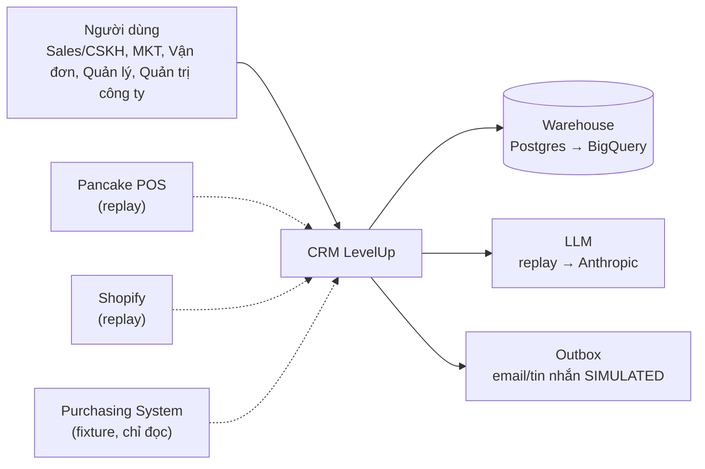

# Kiến trúc (High Level Design)

Cập nhật: 28/10/2026 (Phase 0, trước khi có code). Nguồn: HLD §2, §10; bản thiết kế mục 3, 6; D-01…D-05, D-12, D-13.

## 0. Mục đích, phạm vi

CRM nội bộ LevelUp cho nhiều team/đơn vị kinh doanh (workspace = team, D-29) và brand, nhiều nền tảng bán bất kỳ qua adapter đăng ký (Pancake POS, Shopify là hai adapter đầu, D-28), nhiều thị trường, có AI và lớp phân tích tách riêng. Giai đoạn **demo**: chạy máy phát triển, mọi hệ thống ngoài giả lập qua adapter.

## 1. Ngữ cảnh hệ thống

## 2. Phong cách kiến trúc và lý do

- **Modular monolith** Next.js 15 App Router + worker Node riêng (D-01, D-02). Một repo, một DB, module tách theo thư mục `src/modules/*`, mỗi module chỉ gọi module khác qua `service.ts` (không import `queries.ts` chéo).
- **Adapter cho mọi thứ bên ngoài** (D-05, D-12, D-13). Giao diện ở `src/adapters/*/interface.ts`; cài đặt chọn bằng env tại `src/adapters/index.ts`. Nghiệp vụ không biết đang chạy replay hay thật.
- **Tách OLTP và phân tích**: PostgreSQL cho màn hình; schema `analytics` (view/materialized) cho demo warehouse; BigQuery cùng SQL chuẩn khi lên thật. Màn hình hằng ngày không truy vấn warehouse.
- **Quyền một chỗ**: `lib/rbac.ts` `requirePerm(user, perm, scope?)` dùng chung cho server action, route API, tool AI, truy vấn báo cáo, tìm kiếm.
- **Cô lập workspace ở lớp DB**: `lib/db.ts` bọc Prisma client bằng extension gắn `workspaceId` (mẫu T-53 Purchasing); `bindTenant(user)` đầu mỗi request; `rootDb` chỉ cho health/seed/quản trị công ty có kiểm.

## 3. Phân rã module

| Module | Trách nhiệm | Phụ thuộc |
|---|---|---|
| `auth` | Session, đăng nhập thử, OIDC khung, chọn workspace | — |
| `org` | Workspace, Brand, Store, Market, Team, Role, Membership, FxRate | auth |
| `connectors` | Connection, SyncRun, SourceEvent, điều phối adapter, replay lỗi | org, adapters/connectors |
| `normalize` | Chuẩn hóa đơn/khách, chống trùng, liên kết đơn, hàng đợi xác minh | connectors, orders, customers |
| `orders` | Order, OrderItem, Payment, Refund, Shipment, Return, trạng thái | org, products |
| `products` | Product, Variant, mapping nguồn, PurchasingLink | org |
| `customers` | Customer 360, identity, gộp/tách, địa chỉ, quyền liên hệ | org |
| `sales` | Lead, Assignment, Activity, Task, hàng đợi, kịch bản | customers, orders |
| `service` | Ticket, SLA, KnowledgeArticle | customers, orders, sales |
| `metrics` | MetricDefinition, CustomerMetric, Score, ScoreVersion, Warehouse | orders, customers, adapters/warehouse |
| `marketing` | Segment, Campaign, Touchpoint, Journey, JourneyRun, ContactCap | metrics, customers, messaging |
| `ai` | LlmProvider, tool registry, AgentRun, ToolCall, Approval, AiCost | mọi module qua service |
| `reports` | 6 nhóm báo cáo, dashboard, xuất Excel | metrics |
| `fulfillment` | Đơn cần can thiệp, lý do thất bại, COD 4 mốc, cập nhật hàng loạt | orders, service |
| `admin` | Người dùng, vai trò, cấu hình, audit viewer, xuất/xóa dữ liệu | org |
| `messaging` | Outbox, kênh, SIMULATED | adapters/messaging |
| `audit` | AuditLog, IdempotencyKey | — |

## 4. Worker

Tiến trình `worker/index.mjs` chạy riêng, mỗi job trong `try/catch` theo workspace (mẫu T-70 Purchasing):

| Job | Chu kỳ | Phase |
|---|---|---|
| `sync` | theo `Connection.pollIntervalMin` | 2 |
| `score` | hằng ngày + sự kiện | 6 |
| `journey` | 5 phút | 7 |
| `reminder` (lead, task, SLA) | 5 phút | 4, 5 |
| `outbox` | 1 phút (SIMULATED: chuyển trạng thái, không gửi) | 7 |
| `warehouse.refresh` | hằng ngày | 6 |

`--once` chạy một lượt, lỗi thoát mã 1.

## 5. Dữ liệu

Xem `docs/data-model.md`. Mọi bảng nghiệp vụ: `id` (cuid), `workspaceId`, `createdAt`, `updatedAt`, `createdById`. Bản ghi nguồn thêm bộ trường HLD §4. Tiền `Decimal(18,4)`. Thời gian UTC, hiển thị theo market.

## 6. Luồng chính

Xem `docs/system-flow-diagram.md`. Tóm tắt: nguồn → adapter → `SourceEvent` → chuẩn hóa → `Order`/`Customer` → metrics → score/segment → journey/task → outbox; AI đọc trạng thái mới nhất qua service và ghi qua tool có kiểm quyền.

## 7. Vấn đề xuyên suốt

### 7.1 Phân quyền
`docs/permissions.md`. Che trường (tiền, PII) ở service, không ở UI.

### 7.2 Nhật ký chỉ thêm
`AuditLog` cho mọi sửa nghiệp vụ; `SourceEvent` cho mọi sự kiện nguồn; `AgentRun`/`ToolCall` cho AI. Không xóa, không sửa.

### 7.3 Đồng thời và chống ghi trùng
- `IdempotencyKey` (workspace, scope, key) cho action tạo (task, ticket, outbox, journey step).
- Unique nguồn (workspace, connection, recordType, sourceRecordId).
- So `sourceUpdatedAt` trước khi ghi đè; giao dịch DB cho gộp/tách.

### 7.4 Xử lý lỗi
Service ném `AppError(code, message, httpStatus)`; UI hiện thông báo tiếng Việt + nút thử lại; worker ghi JSON một dòng có `workspaceId`, `job`, `error`.

### 7.5 Ngôn ngữ, thời gian, định dạng
UI vi; dữ liệu khách có `locale`; tiền định dạng theo currency; ngày `dd/MM/yyyy` theo múi giờ market.

### 7.6 Cấu hình
`.env` (bí mật, adapter) + bảng `Setting` theo workspace (ngưỡng SLA, trọng số, cap, giờ làm việc) sửa ở `/quan-tri/cau-hinh`.

### 7.7 Logging và quan sát
`/api/health` (DB, worker heartbeat, outbox pending, freshness warehouse). Log không chứa bí mật/PII.

### 7.8 Bảo mật
Khóa kết nối AES-256-GCM bằng `INTEGRATION_SECRET_KEY`; session ký `SESSION_SECRET`; tool AI chỉ qua service; prompt lọc bí mật/PII ngoài quyền; CSRF theo Next server action; tệp đính kèm lưu ngoài public, kiểm quyền khi tải.

## 8. Yêu cầu phi chức năng (demo)

| Nhóm | Mục tiêu demo | Khi lên thật |
|---|---|---|
| Độ tin cậy | Replay sự kiện không nhân đôi; worker lỗi một workspace không chặn workspace khác | Retry có giới hạn, DLQ |
| Hiệu năng | Trang danh sách < 1s với 2.000 đơn; báo cáo < 3s | Index, materialized, BigQuery |
| Bảo mật | Quyền server, cô lập workspace, không bí mật ở client | SSO, MFA, secret manager |
| Khôi phục | `npm run backup`/`restore` | Lịch, kiểm tra phục hồi |
| Chi phí AI | Đếm token/USD ước tính cả khi replay | Ngân sách, giới hạn |
| Độ trễ đồng bộ | Chưa đặt mục tiêu; polling theo `pollIntervalMin` | Chưa chốt (HLD §10.2, §15) — Q-43 |
| Khôi phục (RPO/RTO) | Chưa đặt; chỉ backup/restore thủ công | Chưa chốt — Q-43 |
| Vùng triển khai, lưu/chuyển dữ liệu xuyên quốc gia | Không áp (máy phát triển) | Chưa chốt; quy định theo từng thị trường, không khẳng định một cấu hình đáp ứng mọi nước (HLD §10.2) — Q-43 |

## 9. Ràng buộc, giả định, rủi ro

- Endpoint Pancake chưa có tài liệu chính thức được xác minh → adapter thật ghi "chưa xác minh".
- Shopify giới hạn 60 ngày lịch sử và protected customer data → backfill thật có thể thiếu.
- BigQuery dialect khác Postgres ở một số hàm (ngày, string) → SQL chỉ số viết chuẩn, ghi chú chỗ khác.
- Dự báo (mua lại, rời bỏ) chỉ có khung trong demo; chất lượng cần dữ liệu thật.

## 10. Truy vết

| Thành phần | R-xx | D-xx |
|---|---|---|
| Workspace, bindTenant | R-01 | D-03 |
| Adapter connector | R-10…R-16 | D-06, D-07, D-13 |
| Warehouse | R-46 | D-05 |
| LlmProvider, tool, approval | R-60…R-65 | D-12 |
| Outbox | R-52 | D-13 |
| Design system | R-75 | D-15 |
