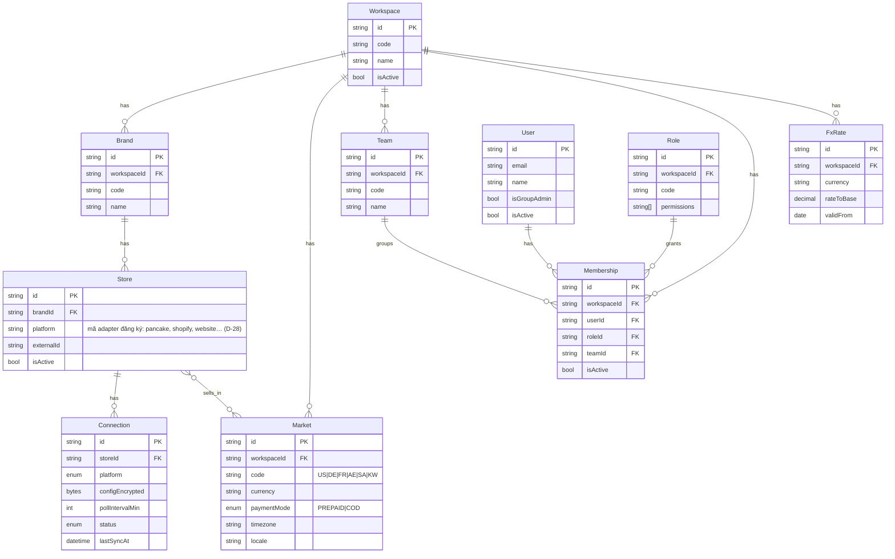
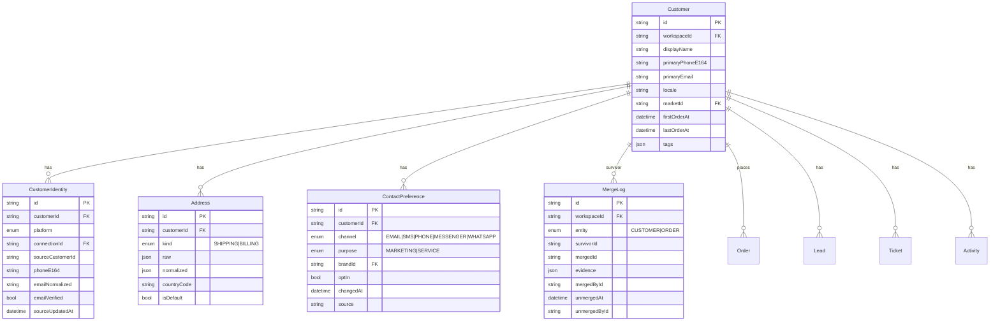
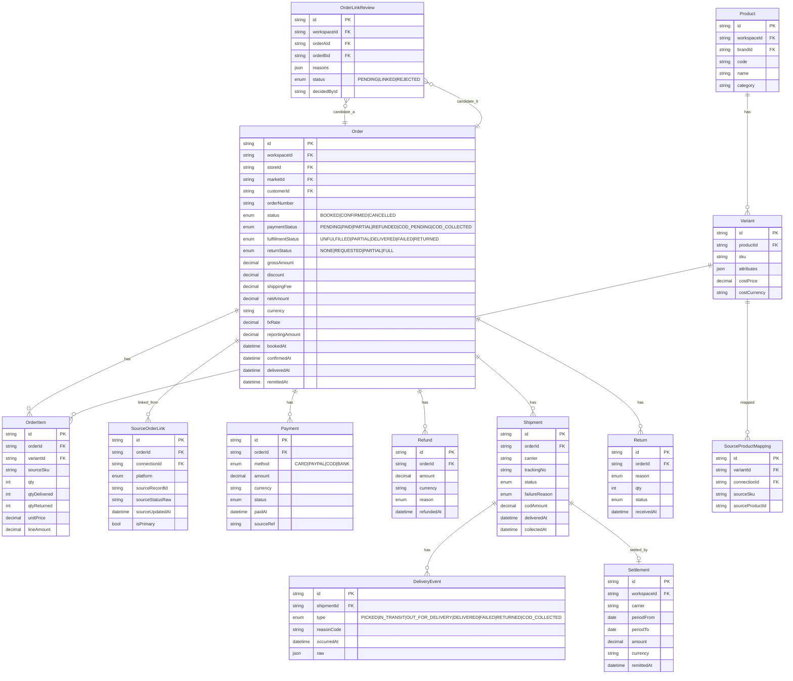
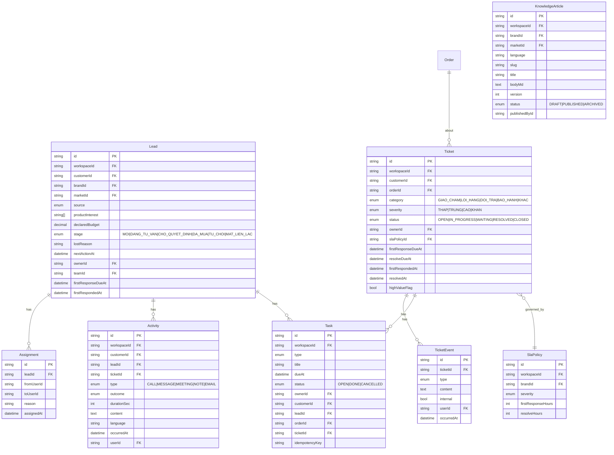

# Mô hình dữ liệu

Cập nhật: 28/10/2026 (Phase 1). Nguồn: HLD §4; bản thiết kế mục 5.

**As-built (Phase 1, migration `20261028092621_init_org`):** `Workspace`, `User` (`isCompanyAdmin`), `Membership` (`roles Role[]`, `teamId`), `Team`, `Brand`, `Market` (`paymentMode PREPAID|COD`), `Store` (`platform` chuỗi, nhiều-nhiều với `Market`), `FxRate` (`Decimal(18,8)`, chỉ thêm), `AuditLog`, `IdempotencyKey`. **Phase 2 (migration `phase2_connectors_orders`):** `Setting`, `Connection`, `SyncRun`, `SyncCheckpoint`, `SourceEvent`, `Product`, `Variant`, `SourceProductMapping`, `Order`, `OrderItem`, `SourceOrderLink` (thêm `orderNumberNorm`, `refs`), `OrderLinkReview`, `MergeLog`, `Payment`, `Refund`, `Shipment`, `DeliveryEvent`. `Order` giữ ảnh chụp khách (`customerName/Phone/Email/SourceId`) — Phase 3 gắn `Customer`. Chưa có: `Return` (dùng `OrderItem.qtyReturned` + `returnStatus`), `Settlement` (Phase 10). **Khác bản đích:** không có bảng `Role` (D-34). **Phase 3 (migration `phase3_customer360`, `phase3_customer_stats`):** `Customer` (thêm `orderCount`, `deliveredOrders`, `valueBase12m`, `statsAt`, `mergedIntoId`), `CustomerIdentity` (unique theo kết nối + mã khách nguồn), `Address`, `ContactPreference` (chỉ thêm), `CustomerReview`; `Order.customerId`. `MergeLog` dùng chung cho đơn và khách (`entity`). **D-44 (migration `base_currency_vnd`):** đổi `rateToUsd→rateToBase`, `netUsd→netBase`, `valueUsd12m→valueBase12m`, tiền quy đổi chung là VND. **Phase 4 (migration `phase4_leads_tasks`, `event_not_owner`):** `Lead` (giai đoạn MOI…MAT_LIEN_LAC, `ownerId`/`teamId`, hạn phản hồi đầu, `idempotencyKey`), `Assignment` (chỉ thêm), `Activity` (CALL/MESSAGE/MEETING/NOTE/SYSTEM, chiều IN/OUT), `Task` (`idempotencyKey`, `remindedAt`), `Script`, `Outbox` (SIMULATED/PENDING/SENT/FAILED), `Notification`; `SourceEvent.outcome` thêm `NOT_OWNER`. Bất biến có test: lead mở luôn có người hoặc nằm ở hàng chờ có báo; gửi lại cùng khóa không tạo lead/việc/tương tác trùng; gộp khách mang theo lead/việc/tương tác và tách lại trả về. **Chịu tải (migration `scale_indexes`, `order_email_trgm`, D-48):** index cho mọi khóa ngoại trên bảng lớn + trigram (`pg_trgm`) cho tìm kiếm; `Lead.lastActivityAt`, `Lead.overdueNotifiedAt` (D-49). Các nhóm còn lại (A2–A5) là bản đích, chưa có trong schema.

Quy ước: mọi bảng nghiệp vụ có `id`, `workspaceId`, `createdAt`, `updatedAt`, `createdById`. Bản ghi nguồn thêm `connectionId`, `sourcePlatform`, `sourceStoreId`, `sourceRecordId`, `sourceUpdatedAt`, `ingestedAt`, `rawPayloadRef`. Tiền: `amount Decimal(18,4)`, `currency`, `fxRate`, `fxDate`, `reportingAmount` (tiền quy đổi chung VND, D-44; trong schema là `netBase`/`valueBase12m`, tỷ giá `FxRate.rateToBase`).

## A1. Tổ chức và danh mục

## A2. Khách và danh tính

## A3. Đơn, sản phẩm, tiền, giao hàng

## A4. Sales, dịch vụ, tri thức

## A5. Chỉ số, điểm, marketing, AI, kỹ thuật

```mermaid
erDiagram
    Customer ||--o{ CustomerMetric : has
    Customer ||--o{ Score : has
    ScoreVersion ||--o{ Score : computed_with
    Segment ||--o{ Journey : triggers
    Journey ||--o{ JourneyRun : has
    Customer ||--o{ JourneyRun : in
    Campaign ||--o{ Touchpoint : has
    Customer ||--o{ Touchpoint : has
    Customer ||--o{ ContactCap : has
    AgentRun ||--o{ ToolCall : has
    AgentRun ||--o{ Suggestion : has
    Suggestion ||--o| Approval : needs
    Connection ||--o{ SyncRun : has
    SyncRun ||--o{ SourceEvent : has

    MetricDefinition { string code PK  string nameVi  string nameEn  text definition  text formula  string timing  string source  string owner  json dimensions  text pitfalls }
    CustomerMetric { string id PK  string customerId FK  date periodStart  date periodEnd  int orders  decimal rev01  decimal rev02  decimal rev03  decimal rev04  decimal refunds  int daysSinceLast  decimal avgCycleDays  decimal margin  datetime computedAt }
    ScoreVersion { string id PK  string workspaceId FK  enum kind "SALES_PRIORITY|RFM|TXN_RISK|SUPPORT_NEED"  int version  json weights  datetime activeFrom }
    Score { string id PK  string customerId FK  string leadId FK  string scoreVersionId FK  decimal value  string band  json reasons  json missingData  string suggestedAction  datetime computedAt }
    Prediction { string id PK  string customerId FK  enum target "BUY_7D|REBUY_60D|DELIVER_OK"  decimal probability  string modelVersion  datetime asOf  datetime evaluatedAt  bool actual }
    Experiment { string id PK  string workspaceId FK  string name  string journeyId FK  decimal holdoutPct  datetime startedAt  json results }
    Segment { string id PK  string workspaceId FK  string name  json conditions  datetime lastEvaluatedAt  int lastCount }
    Journey { string id PK  string workspaceId FK  string name  json trigger  json steps  json exitConditions  bool isActive }
    JourneyRun { string id PK  string journeyId FK  string customerId FK  int currentStep  enum status "ACTIVE|DONE|EXITED"  string exitReason  datetime nextAt }
    ContactCap { string id PK  string customerId FK  enum channel  string brandId FK  int windowDays  int maxContacts  int usedInWindow  datetime windowStart }
    Campaign { string id PK  string workspaceId FK  string brandId FK  string name  enum channel  decimal cost  string currency  date startDate  date endDate }
    Touchpoint { string id PK  string customerId FK  string campaignId FK  json utm  datetime occurredAt  string sourceRef }
    AgentRun { string id PK  string workspaceId FK  string userId FK  string feature  string model  text promptRedacted  text output  json evidence  int tokensIn  int tokensOut  decimal costUsd  enum status  datetime startedAt }
    ToolCall { string id PK  string agentRunId FK  string tool  json args  json result  enum status "OK|DENIED|ERROR|NEEDS_APPROVAL" }
    Suggestion { string id PK  string agentRunId FK  enum kind  json payload  enum status "PENDING|ACCEPTED|REJECTED" }
    Approval { string id PK  string suggestionId FK  string approverId FK  enum decision  text note  datetime decidedAt }
    AiCost { string id PK  string workspaceId FK  date day  string feature  string model  int tokens  decimal costUsd }
    SyncRun { string id PK  string connectionId FK  enum mode "BACKFILL|INCREMENTAL|REPLAY"  datetime startedAt  datetime finishedAt  int applied  int stale  int duplicate  int errors  json cursor }
    SourceEvent { string id PK  string syncRunId FK  string eventKey  enum recordType  string sourceRecordId  datetime sourceUpdatedAt  enum outcome "APPLIED|STALE|NOT_OWNER|DUPLICATE|ERROR"  string error  string rawPayloadRef }
    Outbox { string id PK  string workspaceId FK  enum channel  string to  string subject  text body  enum status "PENDING|SIMULATED|SENT|FAILED"  string idempotencyKey  string relatedEntity  string relatedId  datetime scheduledAt  datetime sentAt }
    AuditLog { string id PK  string workspaceId FK  string actorId  string entity  string entityId  string action  json before  json after  string reason  datetime at }
    IdempotencyKey { string id PK  string workspaceId FK  string scope  string key  string resultRef  datetime createdAt }
```

## B. Trạng thái

| Thực thể | Trạng thái | Chuyển hợp lệ |
|---|---|---|
| `Order.status` | BOOKED → CONFIRMED → (CANCELLED) | Không lùi; CANCELLED cuối |
| `Order.paymentStatus` | PENDING/COD_PENDING → PAID/COD_COLLECTED → PARTIAL/REFUNDED | Theo Payment/Refund |
| `Order.fulfillmentStatus` | UNFULFILLED → PARTIAL → DELIVERED; FAILED; RETURNED | Theo DeliveryEvent, tính từ dòng |
| `Lead.stage` | MOI → DANG_TU_VAN → CHO_QUYET_DINH → DA_MUA / TU_CHOI / MAT_LIEN_LAC | Mọi bước ghi Activity |
| `Ticket.status` | OPEN → IN_PROGRESS ↔ WAITING → RESOLVED → CLOSED | RESOLVED ghi `resolvedAt` |
| `JourneyRun.status` | ACTIVE → DONE / EXITED(reason) | Exit khi điều kiện ra |
| `Outbox.status` | PENDING → SIMULATED (demo) / SENT / FAILED | — |

## C. Bất biến phải kiểm thử

1. Unique (`workspaceId`, `connectionId`, `recordType`, `sourceRecordId`) trên `SourceOrderLink`, `CustomerIdentity`, `SourceProductMapping`.
2. Một `Order` có ≥ 1 `SourceOrderLink`, đúng một `isPrimary`.
3. `Order.reportingAmount = netAmount × fxRate` tại `fxDate`; không cộng khác tiền tệ.
4. `OrderItem.qtyDelivered + qtyReturned ≤ qty`; `fulfillmentStatus` suy từ dòng.
5. Ghi từ nguồn chỉ khi `sourceUpdatedAt` mới hơn bản lưu **và** nguồn là chủ nhóm trường theo `Setting.sourceOfTruth` (D-32); không phải chủ → `SourceEvent.outcome = NOT_OWNER`, không ghi.
6. `MergeLog` tách lại khôi phục `CustomerIdentity.customerId` và `Order.customerId`.
7. `Score` luôn có `scoreVersionId`; đổi trọng số tạo `ScoreVersion` mới, `Score` cũ giữ.
8. `ToolCall` ghi dữ liệu có `status = DENIED` khi thiếu quyền, không có side effect.
9. `Outbox.status = SIMULATED` khi `EXTERNAL_WRITES_ENABLED=false`; `idempotencyKey` unique.
10. Mọi truy vấn bảng có `workspaceId` không có ngữ cảnh → ném lỗi.
