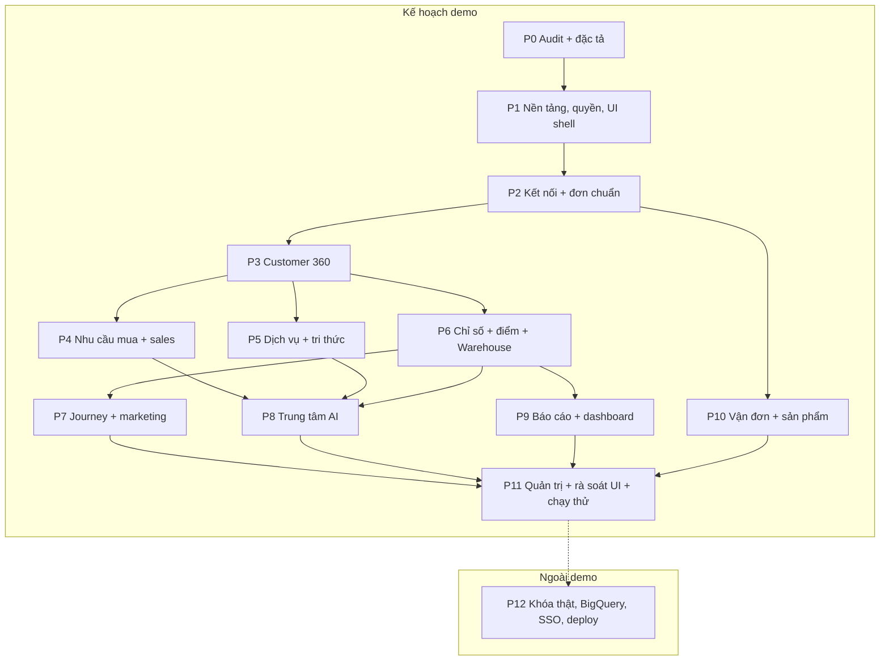
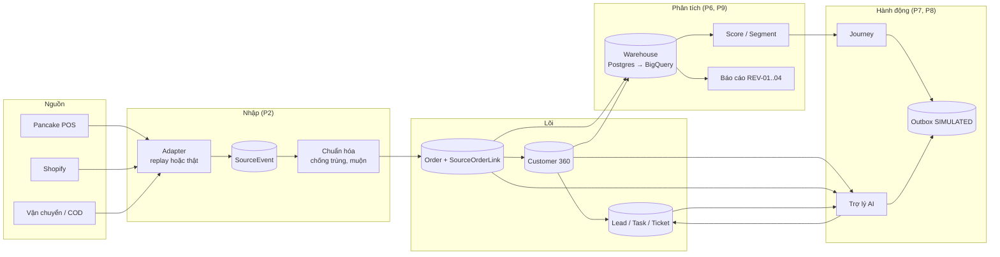
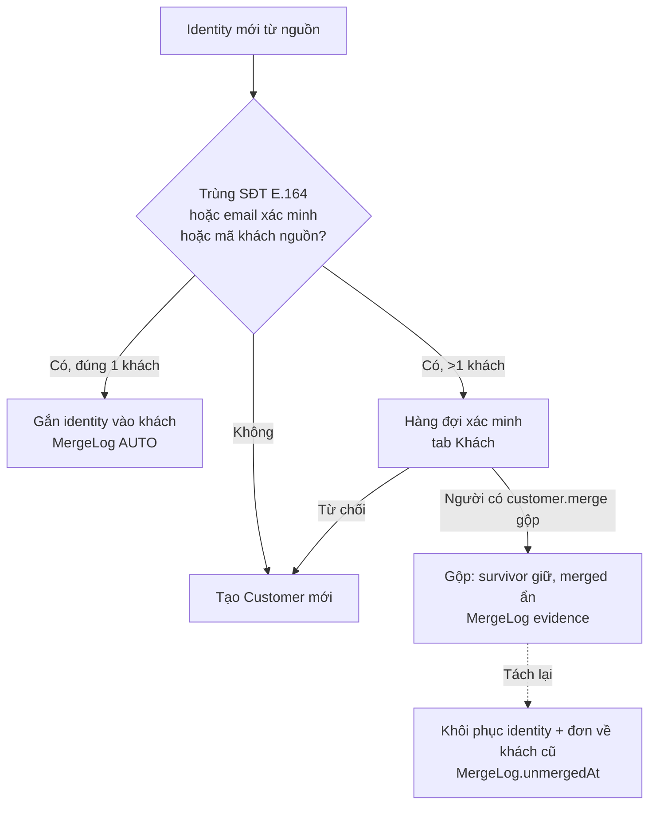
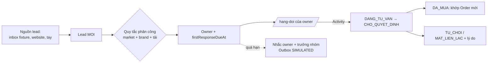
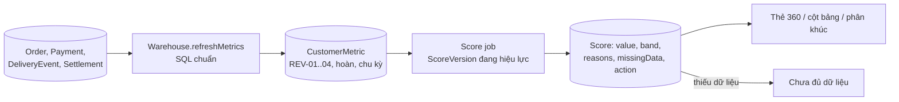
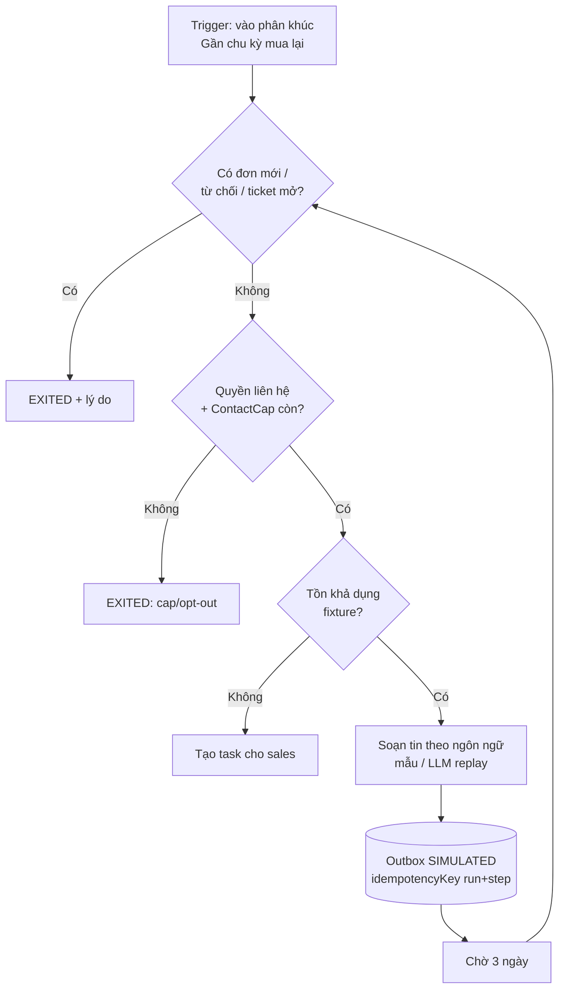
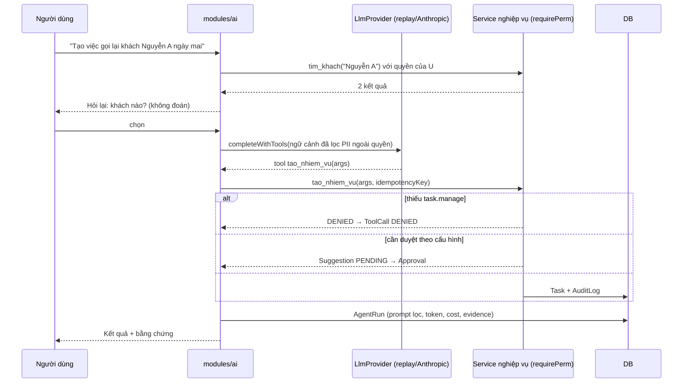
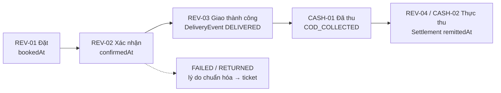

# Sơ đồ tổng hợp CRM LevelUp — toàn bộ phase

Nguồn: bản thiết kế mục 8, 10; HLD §5, §6, §8, §9. Trạng thái 28/10/2026: Phase 0; chưa có code. Khi làm xong phase nào, ghi "đã có code" vào tiêu đề sơ đồ đó.

## 1. Bản đồ phase



## 2. Luồng dữ liệu tổng thể



## 3. Đồng bộ và liên kết đơn hai nguồn (P2)

```mermaid
sequenceDiagram
    participant W as Worker sync
    participant A as Adapter (replay)
    participant N as normalize
    participant DB as PostgreSQL
    W->>A: incremental(since = checkpoint − 10 phút)
    A-->>W: danh sách đơn nguồn (có sourceUpdatedAt)
    loop mỗi bản ghi
        W->>N: upsertFromSource(record)
        N->>DB: tìm SourceOrderLink (connection, recordId)
        alt chưa có
            N->>N: áp linkRules của cặp nền tảng (mã tham chiếu chéo, D-28)
            alt có tham chiếu khớp Order đã có
                N->>DB: thêm SourceOrderLink vào Order đó (isPrimary=false)
            else nghi ngờ (trùng tiền + SĐT + ±30 phút, không mã)
                N->>DB: tạo Order mới + OrderLinkReview PENDING
            else
                N->>DB: tạo Order mới + SourceOrderLink primary
            end
            N->>DB: SourceEvent APPLIED
        else đã có
            alt nguồn không phải chủ nhóm trường (sourceOfTruth, D-32)
                N->>DB: SourceEvent NOT_OWNER (không ghi)
            else sourceUpdatedAt mới hơn
                N->>DB: cập nhật trạng thái theo bảng ánh xạ, giữ raw; SourceEvent APPLIED
            else
                N->>DB: SourceEvent STALE (không ghi)
            end
        end
    end
    W->>DB: SyncCheckpoint = max(sourceUpdatedAt)
```

## 4. Hợp nhất khách (P3)



## 5. Lead → phân công → hàng đợi (P4)



## 6. Ticket và SLA (P5)

```mermaid
stateDiagram-v2
    [*] --> OPEN: tạo (tay / từ vận đơn / AI đề xuất)
    OPEN --> IN_PROGRESS: nhận xử lý (firstRespondedAt)
    IN_PROGRESS --> WAITING: chờ khách / vận chuyển
    WAITING --> IN_PROGRESS: có phản hồi
    IN_PROGRESS --> RESOLVED: resolvedAt
    RESOLVED --> CLOSED: sau 3 ngày hoặc khách xác nhận
    RESOLVED --> IN_PROGRESS: mở lại
    note right of OPEN: SLA theo severity; quá hạn → cờ + nhắc; highValueFlag ưu tiên
```



## 7. Chỉ số và điểm (P6)



## 8. Journey mua lại (P7, HLD §8.5)



## 9. Tác vụ AI có kiểm soát (P8, HLD §8.4)



## 10. Báo cáo đa tiền tệ (P9)

```mermaid
flowchart LR
    F[Bộ lọc: workspace, brand, store,<br/>market, kỳ, tiền tệ báo cáo] --> Q[Warehouse.query<br/>+ scopeFor(user)]
    Q --> R[Kết quả: nguyên tệ,<br/>tỷ giá, VND quy đổi, mã chỉ số]
    Q --> FR[freshness: lần refresh]
    R & FR --> V[Bảng + biểu đồ + định nghĩa]
    V --> X[Xuất Excel]
```

## 11. COD bốn mốc (P10, từ điển LevelUp)



## 12. Bảo mật xuyên suốt

```mermaid
flowchart TD
    REQ[Request / Action / Tool / Query] --> U[requireUser]
    U --> T[bindTenant(workspace)]
    T --> P[requirePerm + scopeFor]
    P --> M[Che trường: tiền, PII]
    M --> S[Service → DB]
    S --> A[(AuditLog / AgentRun)]
    S --> O[(Outbox: SIMULATED khi<br/>EXTERNAL_WRITES_ENABLED=false)]
```
